# Opus 5.5 视频提示词 · Happy AI 中文精选

免费在线看 927 条视频案例，先看效果，再复制中文提示词。 [English](README.en.md)

## [▶ 免费看全部 927 条案例 · 一键复制提示词 →](https://wutuobangai.top/opus55-video-prompts.html?utm_source=github&utm_medium=readme&utm_campaign=opus55-repo)

<table>
<tr>
<td align="center" width="33%"><a href="https://wutuobangai.top/opus55-video-prompts.html?utm_source=github&amp;utm_medium=readme&amp;utm_campaign=opus55-repo#p-2103424524297420829">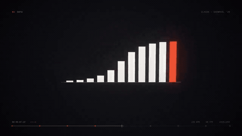</a><br><strong>动效与作品集</strong><br><a href="https://wutuobangai.top/opus55-video-prompts.html?utm_source=github&amp;utm_medium=readme&amp;utm_campaign=opus55-repo#p-2103424524297420829">max 档的动效简历短片</a></td>
<td align="center" width="33%"><a href="https://wutuobangai.top/opus55-video-prompts.html?utm_source=github&amp;utm_medium=readme&amp;utm_campaign=opus55-repo#p-2103835273813496100">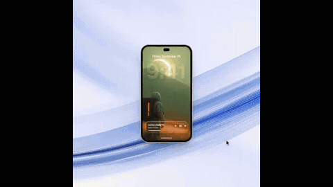</a><br><strong>产品发布与广告</strong><br><a href="https://wutuobangai.top/opus55-video-prompts.html?utm_source=github&amp;utm_medium=readme&amp;utm_campaign=opus55-repo#p-2103835273813496100">苹果发布会风格的发布短片模板</a></td>
<td align="center" width="33%"><a href="https://wutuobangai.top/opus55-video-prompts.html?utm_source=github&amp;utm_medium=readme&amp;utm_campaign=opus55-repo#p-2103454597641891922">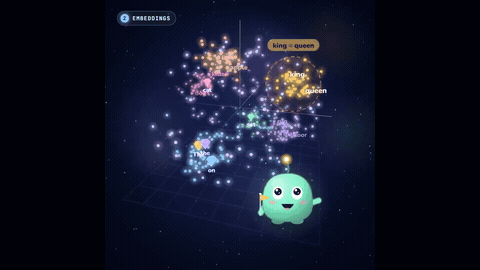</a><br><strong>科普与讲解</strong><br><a href="https://wutuobangai.top/opus55-video-prompts.html?utm_source=github&amp;utm_medium=readme&amp;utm_campaign=opus55-repo#p-2103454597641891922">萌物讲解大语言模型原理</a></td>
</tr>
<tr>
<td align="center" width="33%"><a href="https://wutuobangai.top/opus55-video-prompts.html?utm_source=github&amp;utm_medium=readme&amp;utm_campaign=opus55-repo#p-2102743212922384673">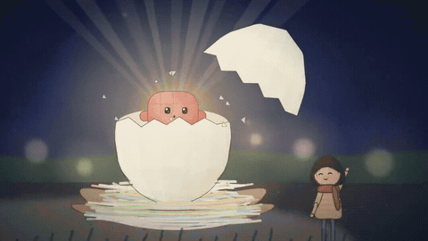</a><br><strong>历史与纪录</strong><br><a href="https://wutuobangai.top/opus55-video-prompts.html?utm_source=github&amp;utm_medium=readme&amp;utm_campaign=opus55-repo#p-2102743212922384673">从人类诞生到 Opus 5.5</a></td>
<td align="center" width="33%"><a href="https://wutuobangai.top/opus55-video-prompts.html?utm_source=github&amp;utm_medium=readme&amp;utm_campaign=opus55-repo#p-2102801274173587569">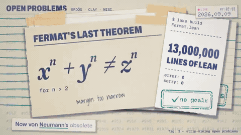</a><br><strong>MV 与歌词动画</strong><br><a href="https://wutuobangai.top/opus55-video-prompts.html?utm_source=github&amp;utm_medium=readme&amp;utm_campaign=opus55-repo#p-2102801274173587569">Claude Pop 新版 MV</a></td>
<td align="center" width="33%"><a href="https://wutuobangai.top/opus55-video-prompts.html?utm_source=github&amp;utm_medium=readme&amp;utm_campaign=opus55-repo#p-2102476258948927543">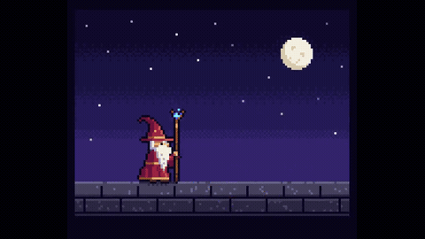</a><br><strong>叙事、手绘与定格</strong><br><a href="https://wutuobangai.top/opus55-video-prompts.html?utm_source=github&amp;utm_medium=readme&amp;utm_campaign=opus55-repo#p-2102476258948927543">施法的像素风巫师</a></td>
</tr>
<tr>
<td align="center" width="33%"><a href="https://wutuobangai.top/opus55-video-prompts.html?utm_source=github&amp;utm_medium=readme&amp;utm_campaign=opus55-repo#p-2103228872577765420">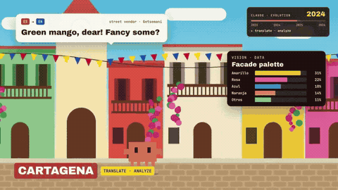</a><br><strong>让 Opus 讲自己</strong><br><a href="https://wutuobangai.top/opus55-video-prompts.html?utm_source=github&amp;utm_medium=readme&amp;utm_campaign=opus55-repo#p-2103228872577765420">Claude 吉祥物游哥伦比亚</a></td>
<td align="center" width="33%"><a href="https://wutuobangai.top/opus55-video-prompts.html?utm_source=github&amp;utm_medium=readme&amp;utm_campaign=opus55-repo#p-2103129343253778767">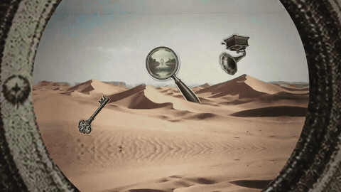</a><br><strong>3D、着色器与世界</strong><br><a href="https://wutuobangai.top/opus55-video-prompts.html?utm_source=github&amp;utm_medium=readme&amp;utm_campaign=opus55-repo#p-2103129343253778767">穿过复古物件的无限缩放</a></td>
<td align="center" width="33%"><a href="https://wutuobangai.top/opus55-video-prompts.html?utm_source=github&amp;utm_medium=readme&amp;utm_campaign=opus55-repo#p-2103194052850241739">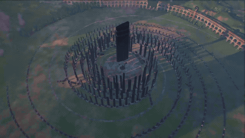</a><br><strong>可互动网页</strong><br><a href="https://wutuobangai.top/opus55-video-prompts.html?utm_source=github&amp;utm_medium=readme&amp;utm_campaign=opus55-repo#p-2103194052850241739">奇异建筑三维世界漫游</a></td>
</tr>
</table>

**30 条精选 · 10 个分类 · 每类 3 条。** 点动图直接看对应案例，展开下方提示词就能复制。

## 按你想做的效果找

| 分类 | 站内案例数 | 本仓库精选 |
| --- | ---: | ---: |
| [动效与作品集](#category-showreel) | 343 | 3 |
| [产品发布与广告](#category-launch) | 136 | 3 |
| [科普与讲解](#category-explainer) | 120 | 3 |
| [历史与纪录](#category-history) | 20 | 3 |
| [MV 与歌词动画](#category-music) | 18 | 3 |
| [叙事、手绘与定格](#category-story) | 36 | 3 |
| [让 Opus 讲自己](#category-self) | 16 | 3 |
| [3D、着色器与世界](#category-worlds) | 126 | 3 |
| [改编与复刻](#category-remix) | 14 | 3 |
| [可互动网页](#category-interactive) | 98 | 3 |

## 怎么用

1. 点动图看效果，找到想做的画面。
2. 展开提示词，把产品、主题和素材换成自己的；站内还能切换中文与原文。
3. 发给你的 Claude，按提示词一起提供参考图、歌曲或原始视频。

免费的是这份资料，生成作品可能需要你已有的模型订阅或其他付费工具；案例展示不代表每次都能一键复现。

选编依据是 2026-10-11 的站内快照：30 条均有完整且非片段的提示词、原帖和本地视频。各类优先挑收录时播放量较高的案例，再看画面选片段；互动类未记录播放量，按画面选择。完整库共 927 条，其中 306 条标记为完整提示词。

## 30 条精选提示词

<a id="category-showreel"></a>

### 动效与作品集

#### 01 · 单个形状变形的 UI 动效循环

[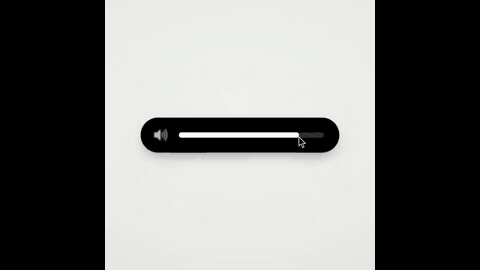](https://wutuobangai.top/opus55-video-prompts.html?utm_source=github&utm_medium=readme&utm_campaign=opus55-repo#p-2103273003555402193)

**作者 [@twoclipping](https://x.com/twoclipping/status/2103273003555402193)** · [看完整效果](https://wutuobangai.top/opus55-video-prompts.html?utm_source=github&utm_medium=readme&utm_campaign=opus55-repo#p-2103273003555402193) · 收录时播放量 933,764

收录来源：[yihui-dev](https://github.com/yihui-dev/awesome-opus5-5-videos) · MIT / [Li-Evan](https://github.com/Li-Evan/awesome-opus-5.5-video-prompts) · CC BY 4.0

同一个形状踩着 120 BPM 变成按钮、播放器、滑块、图表等，首尾无缝循环的方形 UI 动效。

<details>
<summary>展开完整中文提示词</summary>

```text
<inputs>
先问我要：8 到 12 个我希望这个形状变成的 UI 状态（例如按钮、加载器、播放器、滑块、开关、标签页、图表、命令面板、提示条），纯黑白还是一种强调色，以及一首 120 BPM 左右的免版税歌曲（例如 Mixkit，可免费商用）。
</inputs>

<direction>
Dribbble 水准的 UI 动效。只有一个形状，全程不切镜：每个状态都是同一个元素在改变尺寸、圆角和颜色，内容借一个短暂的模糊完成切换。每次变化都由光标通过真实的点击和拖拽驱动。浅暖灰画布，黑白组件，一种干净的 UI 字体（Geist）。处处用弹簧动画，最多只有一点点过冲。镜头缩放，让每个状态都填满画面。最后一帧就是第一帧，所以能循环。
禁止：弹跳缓动、粒子爆发、辉光、UI 外框上的渐变、图标描边粗细不一、空档时间、任何看起来像模板的东西。
</direction>

<structure>
120 BPM，7 小节，每一拍都有事发生。
按钮 → 加载器 → 对勾 → 灵动岛 → 带播放/暂停变形的音乐播放器 → 拖动进度条 → 它变成音量滑块，拖过最大值时会被拉长 → 开关踩着节拍翻转 → 开关的圆钮变成液态的标签指示条 → 标签页展开成一张自己画出来的图表，悬停时有提示框 → 它收拢成 ⌘K → 输入筛选 → 回车 → 提示条 → 回到按钮。
</structure>

<build>
1. 一个 HTML 文件，正方形 1440x1440。所有样式都在 seek(t) 里由时间算出：不用 CSS 过渡，不用定时器，帧与帧之间不保留任何状态。
2. 弹簧用闭式阶跃响应。一个值如果多次改变目标，就等于每次改变各对应一个弹簧的叠加，这样它仍然是时间的纯函数。
3. 标签指示条的两条边各用不同的弹簧，所以前沿会比后沿先拉伸出去。开关圆钮也用同样的技巧。
4. 拖拽是直接操控：光标按住时，数值由光标位置算出；松开后，从当时所在的位置弹回。
5. 用 numpy 分析歌曲得到节拍网格，从一个强拍开始。每个 UI 音效按它实测的峰值位置来放。
6. 用 Playwright 渲染：每帧 4 个子帧，用 ffmpeg tmix 混合，得到 60fps 的动态模糊。
7. 完整渲染前，先每拍渲染一帧。把偏离网格、太挤或难以看清的地方都修好。
</build>

<gotchas>
镜头会缩放的元素一律不要加 will-change，否则文字会渲染发虚。在变形容器里切换的文字需要各自的进场和退场时间，不然会重叠。让最后一帧和第一帧完全一致，包括光标的位置和速度，否则循环会卡顿。
</gotchas>

<start>
先问我要输入，然后在写任何代码之前，先把状态列表排在节拍网格上给我看。
</start>
```

</details>

<details>
<summary>查看原文提示词</summary>

```text
<inputs>
Ask me for: 8 to 12 UI states I want the shape to become (e.g. button, loader, player, slider, toggle, tabs, chart, command palette, toast), pure black and white or one accent color, and a royalty-free song around 120 BPM (e.g. Mixkit, free for commercial use).
</inputs>

<direction>
Dribbble-level UI motion. One shape, never cut: every state is the same element morphing its size, radius and color while its content swaps with a short blur. A cursor drives every change with real clicks and drags. Light warm-gray canvas, black and white components, one clean UI font (Geist). Springs everywhere, a tiny overshoot at most. The camera zooms so each state fills the frame. The last frame is the first frame, so it loops.
Banned: bouncy easing, particle bursts, glows, gradients on UI chrome, mismatched icon strokes, dead time, anything that looks like a template.
</direction>

<structure>
120 BPM, 7 bars, something happens on every beat.
Button → loader → check → dynamic island → music player with a play/pause morph → scrub the progress bar → it becomes a volume slider that stretches when dragged past max → a toggle flips on the beat → the knob becomes a liquid tab indicator → the tabs open into a chart that draws itself, with a tooltip on hover → it collapses into ⌘K → type to filter → enter → toast → back to the button.
</structure>

<build>
1. One HTML file, square 1440x1440. Every style is computed from time inside seek(t): no CSS transitions, no timers, no state carried between frames.
2. Springs are closed-form step responses. A value that changes target many times is the sum of one spring per change, so it stays a pure function of time.
3. The tab indicator's two edges ride different springs, so the leading edge stretches ahead of the trailing one. Same trick for the toggle knob.
4. Drags are direct manipulation: while the cursor is held, the value is computed from its position. On release it springs back from wherever it was.
5. Analyze the song with numpy for the beat grid and start on a downbeat. Place every UI sound by its measured peak.
6. Render with Playwright: 4 subframes per frame, blended with ffmpeg tmix for motion blur at 60fps.
7. Render one frame per beat before the full render. Fix anything off the grid, cramped or hard to read.
</build>

<gotchas>
Never put will-change on anything the camera scales or the text renders blurry. Text that swaps inside a morphing container needs its own enter and exit timing or it overlaps. Make the last frame identical to the first, cursor position and speed included, or the loop stutters.
</gotchas>

<start>
Ask me for the inputs, then show me the state list on the beat grid before you write any code.
</start>
```

</details>

#### 02 · max 档的动效简历短片

[](https://wutuobangai.top/opus55-video-prompts.html?utm_source=github&utm_medium=readme&utm_campaign=opus55-repo#p-2103424524297420829)

**作者 [@darel023](https://x.com/darel023/status/2103424524297420829)** · [看完整效果](https://wutuobangai.top/opus55-video-prompts.html?utm_source=github&utm_medium=readme&utm_campaign=opus55-repo#p-2103424524297420829) · 收录时播放量 65,971

收录来源：[Li-Evan](https://github.com/Li-Evan/awesome-opus-5.5-video-prompts) · CC BY 4.0

max 档做的 15 秒动效简历短片：第一秒给钩子，接着是字体、形状、镜头运动和色彩变化，节奏像卡着音乐剪。

<details>
<summary>展开完整中文提示词</summary>

```text
你是世界级的动效设计师，这是你的 15 秒简历作品集。要有动感、有自信：第一秒就用一个抓人的钩子开场，接着依次展示一系列不同的技法（字体排印、形状玩法、镜头运动、色彩变化），最后落在一个干净、令人难忘的结束画面上。节奏要像是卡着音乐剪出来的。放开了做。
```

</details>

<details>
<summary>查看原文提示词</summary>

```text
You're a world-class motion designer, and this is your 15-second résumé reel. Make it dynamic and confident: open with a striking hook in the first second, build through a sequence of distinct techniques (typography, shape play, camera moves, colour shifts), and land on a clean, memorable final frame. Pacing should feel like it's cut to music. Go crazy.
```

</details>

#### 03 · 手游高光时刻动效模板

[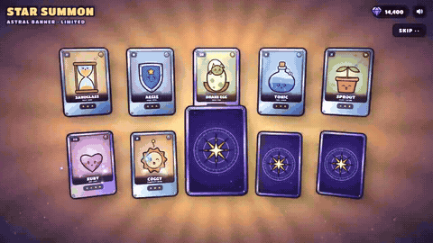](https://wutuobangai.top/opus55-video-prompts.html?utm_source=github&utm_medium=readme&utm_campaign=opus55-repo#p-2104085484347818226)

**作者 [@op7418](https://x.com/op7418/status/2104085484347818226)** · [看完整效果](https://wutuobangai.top/opus55-video-prompts.html?utm_source=github&utm_medium=readme&utm_campaign=opus55-repo#p-2104085484347818226) · 收录时播放量 65,100

收录来源：[yihui-dev](https://github.com/yihui-dev/awesome-opus5-5-videos) · MIT / [Li-Evan](https://github.com/Li-Evan/awesome-opus-5.5-video-prompts) · CC BY 4.0

手游「高光时刻」动效模板，如开宝箱、段位晋升：Three.js 卡通 3D 主体、五段式演出、GSAP 编排。

<details>
<summary>展开完整中文提示词</summary>

```text
帮我做一个原创的手游「高光时刻」动效：[主体，例如：开宝箱 / 段位晋升 / 成就解锁 / Boss 掉落 / 角色升级]。
做成一个可以直接打开的单文件网页（HTML + CSS + JS），点一下就能完整播放，效果对标商业手游的结算 / 奖励演出。

【世界观与风格】
- 原创美术，不要模仿任何现有游戏的 IP、角色或 Logo。
- 卡通手游风：高饱和配色，统一的深色描边（例如 #1A1033），圆润厚重的造型。
- 配色随等级升级：[等级阶梯，例如：普通绿 → 稀有蓝 → 史诗紫 → 传说金]。每升一级都要切换主色、光效颜色和背景色调。
- 标题用圆胖的游戏字体（如 Titan One / Lilita One），描黑边，加投影；文字逐字「砸」进画面，带回弹。

【主体物：做成真 3D】
- 用 Three.js 建模，不要用平面 SVG 贴图。要有厚度、倒角，以及符合主体的结构细节（木板缝、铆钉、包边、宝石切面、锁扣等）；木板缝这类细节用真实几何体拼出来，不要贴黑线条。
- 着色用卡通分阶（MeshToonMaterial 加 3～4 阶的渐变贴图），配三种灯光：主光、天光、等级色的轮廓光。
- 描边用后期边缘检测：渲染法线图 + 深度图，再用着色器画线。外轮廓粗、零件交界细，粗细全程一致；另外做 1.5 倍超采样和多重采样抗锯齿。
  不要用「放大一圈的黑色背面」那种描边，那样粗细不均、转角会断。
  深度判断的阈值要放宽，接缝主要靠法线判断，否则斜着看的表面会冒出细碎斜纹。
- 活动部件要真实运动，比如箱盖绕铰链翻开、奖章绕竖轴旋转。
- 待机时主体缓慢左右转动，让人看到侧面和厚度，同时轻微上下浮动；脚下要有随高度变化的柔和投影。

【如果画面里有 2D 插画（卡面、奖励图标、角色）】
- 三层卡通着色：底色、成块的阴影色、高光色，不要只用一层渐变。
- 线条分粗细：外轮廓粗，内部结构线细。
- 每个角色或物件要有自己的表情和姿态，不要所有东西共用同一张脸。
- 脚下画投影，让主体「站」在画面里；背景按属性区分图案，不要全用同一套放射线。

【演出节奏：五个阶段，缺一不可】
1. 预备：主体待机浮动，每隔几秒抖一下提示可以点击，底部显示「点击」提示。
2. 升级：每点一次，主体跳起、在空中转一圈、落地时压扁再回弹；同时切换到下一等级的颜色，闪一下光，冒一圈粒子，标题更新。
3. 蓄力（约 1 秒）：主体越抖越剧烈，缝隙透出光，四周粒子往中心吸，音效音调持续上升；最后一刻猛地压扁。
4. 爆发：从爆点向外扩散的泛光闪白、屏幕震动、镜头往前一推、多层冲击波、细长流光迸射、闪光星点、金币和宝石（带旋转）。高等级的爆发要明显更强。彩带只在最高潮用一次，不要满屏彩带。
5. 揭晓与结算：
   - 奖励卡片从主体里沿弧线飞出，落位时带超调和晃动收尾，数字滚动计数。
   - 稀有物品带彩虹流光边框和「NEW!」角标。
   - 点击领取后，金币和宝石沿贝塞尔曲线飞进右上角的余额，每到一个余额就跳一下。

【揭晓舞台：让主角独占画面】
- 最高稀有度揭晓时，其他元素收起或淡出，背后换成一层干净的渐变幕布加缓慢旋转的柔光，不要让主角压在杂乱的背景上。
- 幕布出现时，把场景里的其他 3D 物件隐藏掉，否则后期描边会把它们的轮廓线画在幕布上。
- 主角的外发光要放在主体背后，只从边缘溢出，不能盖在主体前面把它糊成一片白。
- 可以加一圈围绕主角盘旋的星尘拖尾，但轨道必须完整在主角轮廓外侧，不能从主体正面扫过。

【光效：必须柔和，不能有硬边】
- 背景光芒：用带渐变过渡的 conic-gradient，不要一刀切的色块边缘；叠 2～3 层不同密度、不同转速的光。
- 光柱：由 5～7 道带模糊的光束呈扇形散开，亮度各自轻微闪动；根部加一团柔光核心，光里有光尘缓慢上飘。
- 闪白：从爆点向外的径向泛光（mix-blend-mode: screen），强度不超过 0.8，不要整屏纯白过曝。
- 粒子：每个火花都带一圈低透明度的外晕；冲击波用三层描边（宽而淡、中等、细而亮）。

【材质与界面】
- 边框、名牌、按钮要有材质感：金属拉丝渐变、左上亮右下暗的倒角光、内阴影；按稀有度换镶嵌件（钢铆钉 → 银框宝石 → 金框钻石加小王冠）。
- 小卡片上不要塞小字数值；详细数值放到揭晓时的信息面板里，面板里的数字滚动上涨，并弹出「▲+数值」。
- 画在 Canvas 上的贴图，分辨率至少是屏幕上最大显示尺寸的 1.5 倍，否则放大时会发虚。

【动画原则】
- 用 GSAP 时间线编排。所有动作都要有挤压拉伸、超调和弹性回弹，不要匀速。
- 粒子系统用 Canvas 2D 自己写：重力、阻力、生命周期、叠加混合，以及「吸入」「曲线飞行」「环绕」三种运动。
- 不要用 CSS 3D 透视去翻转大尺寸元素，放大加侧翻时会被投影成铺满屏幕的平面，3D 翻转一律放在 WebGL 里做。
- 所有「抖动」「呼吸」类的循环补间，在状态切换时要先取消再归零，避免它比停止指令晚一帧结束，又把值设回去。

【音效】
- 全部用 Web Audio 实时合成，不用音频文件：跳起、落地、升级和弦、蓄力上升音、爆炸低频加噪声、弹出音、计数滴答、金币叮当、胜利号角。
- 第一次点击时才初始化音频；右上角放静音开关。

【界面与工程】
- 顶部 HUD：模式切换、金币和宝石余额、静音按钮。
- 手机宽度也要能用；遵守「减少动态效果」设置（关闭震屏，减少粒子）。
- 动画状态机要严谨：动画播放中忽略点击，不能出现点击被吞或状态错乱。
- 目标 60fps。第一次打开时就是完整的待机画面，不能是空白。

【交付前自检】
在蓄力、爆发、揭晓、结算这几个时刻各截一张图，逐张检查：
- 主角有没有被光晕、粒子或文字挡住？
- 有没有过曝成一片白？
- 背景是否杂乱，有没有穿帮的描边线？
- 小字是否能看清？
- 结算后是否还有东西在不该动的时候继续抖动？

最后告诉我：每个阶段的时长，以及哪些参数可以调整演出强度。
```

</details>

<details>
<summary>查看原文提示词</summary>

```text

```

</details>

<a id="category-launch"></a>

### 产品发布与广告

#### 04 · 苹果发布会风格的发布短片模板

[](https://wutuobangai.top/opus55-video-prompts.html?utm_source=github&utm_medium=readme&utm_campaign=opus55-repo#p-2103835273813496100)

**作者 [@twoclipping](https://x.com/twoclipping/status/2103835273813496100)** · [看完整效果](https://wutuobangai.top/opus55-video-prompts.html?utm_source=github&utm_medium=readme&utm_campaign=opus55-repo#p-2103835273813496100) · 收录时播放量 99,440

收录来源：[yihui-dev](https://github.com/yihui-dev/awesome-opus5-5-videos) · MIT / [Li-Evan](https://github.com/Li-Evan/awesome-opus-5.5-video-prompts) · CC BY 4.0

29 秒一镜到底的发布短片，每个场景都从上一个变形而来：液态玻璃、光圈转场、实拍墙面，全卡 120 BPM。

<details>
<summary>展开完整中文提示词</summary>

```text
<inputs>
先问我要：一个用作文字标志的单词品牌名（动词效果最好）、9 到 12 张高分辨率照片、一首 120 BPM 左右、有 drop 和安静间奏段的免版税歌曲（Mixkit，可免费商用），以及一段植物影子在素墙上晃动的免费素材视频（Pexels）。
</inputs>

<direction>
一支苹果发布会风格的发布短片，只用 2D，一镜到底。每个场景都由上一个场景变出来：没有淡入淡出、没有模糊、没有剪切。物体靠改变形状来过渡：文字从遮罩线里升起，图标用弹簧从零弹出，条形横向画出，页面推入，一个黑色形状铺满整个画面，再收缩成下一个场景。暖白色画布，黑色 UI，照片上叠 iOS 26 液态玻璃。文字标志用 Archivo（wdth 125，字重 800），UI 用 Geist。每次变化都由光标通过真实的点击、拖拽和长按驱动。镜头像 Screen Studio 那样缩放，让每个瞬间都填满方形画面，光标也随之缩放。
禁止：交叉淡化、模糊入场、亮度「显影」、3D 翻转、粒子、辉光、停顿超过 1 秒、任何看起来像模板的东西。
</direction>

<structure>
120 BPM，54 拍，每一拍都有事发生。
开场：文字标志像手风琴一样挤进自己的句号，这个点长成一个黑色胶囊，里面升起一个标签。点击：六片光圈叶片合拢盖住标签，再猛地张开，露出一张照片。圆形变成方形并缩小，网格像纸质地图一样从它背后展开（中心、十字、四角），重排成 bento 布局，一次点击放大进其中一格，正好落在 drop 上。
玻璃：一个玻璃质感的单词逐字弹出，融化成一滴水珠，再拉伸成一条玻璃工具栏。调节图标把它变成滑块。拖动滑块把照片从白天重新打光成黄金时刻（两张对齐的照片），按住时滑块圆钮变成一枚玻璃透镜。它升起成一个玻璃球，下一张照片在球里以圆形打开，玻璃球再扩展成锁屏：玻璃质感的时钟数字、日期，以及一条拉伸成玻璃音乐播放器的 Home 条。
舞台：锁屏往后拉，变成一部手机（边框从屏幕边缘长出来）。灵动岛像液体一样拉长、掐断、飞过去，长成一个 Mac 窗口，再像百叶帘一样卷起。长按壁纸，把它拖到一个 Safari 标签页上，页面推入，松手后它成为一个落地页的主视觉。滚动：主视觉变形成商品卡片上的装裱画，卡纸和画框线条从照片边缘长出来。选一个画框颜色（颜色会刷过去）和一个尺寸，然后导航按钮飞下来变成「Order print」。
下单：一个黑色形状持续变形：Ordered ✓ → Printing % → On its way（一辆货车走在路线上）→ Delivered ✓。
墙面：送达的圆形从边到边铺满画面，保持黑色一拍，然后收缩成挂在真实墙面素材上的装裱画。同一个光圈在画上打开、再合上，画框铺满屏幕，再收缩成胶囊 → 点 → 字母弹回来，正好落在节拍回归处。最后一帧 = 第一帧。
</structure>

<build>
1. 一个 HTML 文件，正方形 1440x1440。所有样式都在一个 async seek(t) 里由时间算出：不用 CSS 过渡，不用定时器，帧与帧之间不保留状态。
2. 弹簧用闭式阶跃响应。一个有多个目标的值，等于每次改变各对应一个弹簧的叠加，所以它仍是时间的纯函数。
3. 液态玻璃：每个玻璃元素持有一份它背后场景的克隆，用 SVG feImage 位移贴图（一个圆角矩形距离场）过滤，经过三个比例略有不同的 feDisplacementMap 形成色散边缘，再加一圈边缘高光。玻璃字母：每个字形用一个 canvas 距离场生成贴图、遮罩和高光。
4. 粘滞（Goo）效果：模糊 + alpha 阈值，然后把源图合成在上面，让玻璃内部保持清晰。
5. 光圈：6 片叶片围绕一个六边形孔径。每片叶片由它的两个顶点、两条边的延长线以及两点之间较短的那段弧组成。
6. 文字标志挤压：每个字母都按同一个系数向句号靠拢，字形宽度随之变化（收窄 wdth 轴，其余部分缩放），这样字母始终挨在一起。
7. 素材视频：用全帧内编码重新编码（ffmpeg -g 1），以 blob URL 加载，每画一帧前 await 'seeked'。
8. 声音：每个事件都用一个下载的音效（Mixkit），绝不合成，每个都按它实测的峰值位置放置。歌曲从强拍开始：放大正好落在 drop 上，墙面段落放在安静间奏里，文字标志随节拍回归。响度标准化到 -14 LUFS。
9. 用 Playwright 渲染：每帧 4 个子帧，用 ffmpeg tmix 混合，60fps。每拍检查一帧，然后扫描单帧跳变（帧差达到相邻帧 3 倍的尖峰）。
</build>

<gotchas>
在 Chromium 里 backdrop-filter: url() 会读错位移贴图，所以改为克隆场景。铺满动画必须放大到超出四角，并且用大约 0.3 秒，否则半个屏幕会在一帧之内突变。父元素隐藏时，设了 visibility: visible 的子元素仍会显示出来，所以要用 inherit。在变形形状里切换的文字需要它自己的遮罩。python http.server 不能按范围跳转视频，所以用 blob URL。
</gotchas>

<start>
先问我要输入，然后在写完整短片之前，给我看节拍图和 4 张静帧（开场、玻璃、舞台、墙面）。
</start>
```

</details>

<details>
<summary>查看原文提示词</summary>

```text
<inputs>
Ask me for: a one-word brand name for the wordmark (a verb works best), 9 to 12 high-res photos, a royalty-free song around 120 BPM with a drop and a quiet breakdown (Mixkit, free for commercial use), and a free stock clip of a plain wall with moving plant shadows (Pexels).
</inputs>

<direction>
An Apple-keynote launch film, 2D only, one continuous take. Every scene is made out of the previous one: nothing fades, blurs or cuts. Objects change shape instead: text rises out of a mask line, icons pop from zero on a spring, bars draw across, pages push, and a black shape floods the whole frame and contracts into the next scene. Warm off-white canvas, black UI, iOS 26 liquid glass over the photos. Archivo (wdth 125, weight 800) for the wordmark, Geist for UI. A cursor drives every change with real clicks, drags and long-presses. The camera zooms screen-studio style so each moment fills the square, and the cursor scales with it.
Banned: crossfades, blur-ins, brightness "developing", 3D flips, particles, glows, holds longer than 1s, anything that looks like a template.
</direction>

<structure>
120 BPM, 54 beats, something happens on every beat.
Open: the wordmark squeezes into its own period like an accordion, the dot grows into a black pill, a label rises inside it. Click: six iris blades close over the label and snap open onto a photo. The circle becomes a square, shrinks, the grid unfolds from behind it like a paper map (center, plus, corners), reflows into a bento, and a click zooms into one tile, landing exactly on the drop.
Glass: a glass word pops in letter by letter, melts into a droplet that stretches into a glass toolbar. The adjust icon turns it into a slider. Dragging relights the photo from day to golden hour (two aligned shots), and the knob turns into a glass lens while held. It lifts into a glass orb, the next photo opens inside it as a circle, and the orb expands into a lock screen: glass clock digits, date, and a home bar that stretches into a glass music player.
Stage: the lock screen pulls back into a phone (the bezel grows out of the screen edge). The Dynamic Island stretches like liquid, pinches off, flies over and grows into a Mac window that rolls up like a blind. Long-press the wallpaper, drag it onto a Safari tab, the page pushes in, drop it and it becomes the hero of a landing page. Scroll: the hero morphs into a framed print on a product card, with the mat and molding growing out of the photo's edge. Pick a frame color (it paints across) and a size, then the nav button flies down into "Order print".
Order: one black shape keeps morphing: Ordered ✓ → Printing % → On its way (a van on a route) → Delivered ✓.
Wall: the delivered circle floods the frame edge to edge, holds black for a beat, and contracts into the framed print hanging on the real wall footage. The same iris opens onto the print, closes again, the frame floods the screen and contracts into the pill → the dot → the letters spring back out, landing on the beat return. Last frame = first frame.
</structure>

<build>
1. One HTML file, square 1440x1440. Every style is computed from time inside an async seek(t): no CSS transitions, no timers, no state between frames.
2. Springs are closed-form step responses. A value with many targets is the sum of one spring per change, so it stays a pure function of time.
3. Liquid glass: each glass element holds its own clone of the scene behind it, filtered with an SVG feImage displacement map (a rounded-rect distance field) through three feDisplacementMaps at slightly different scales for chromatic edges, plus a rim light. Glass letters: a canvas distance field per glyph gives the map, mask and highlights.
4. Goo: blur + alpha threshold, then composite the source atop it so the glass stays sharp inside.
5. Iris: 6 blades around a hexagonal aperture. Each blade is its two vertices, both edge extensions and the SHORT arc between them.
6. Wordmark squeeze: every letter moves toward the dot by the same factor and its drawn width follows (narrow the wdth axis, scale the rest), so the letters stay touching.
7. Footage: re-encode all-intra (ffmpeg -g 1), load it as a blob URL, await 'seeked' before drawing each frame.
8. Sound: a downloaded SFX for every event (Mixkit), never synthesized, each placed by its measured peak. The song starts on a downbeat: the zoom lands on the drop, the wall sits in the breakdown, the wordmark returns with the beat. Loudnorm to -14 LUFS.
9. Render with Playwright: 4 subframes per frame blended with ffmpeg tmix, 60fps. Check one frame per beat, then scan for single-frame pops (frame-difference spikes 3x their neighbours).
</build>

<gotchas>
backdrop-filter: url() misreads displacement maps in Chromium, so clone the scene instead. A flood must overscale past the corners and take about 0.3s, or half the screen changes in one frame. A child with visibility: visible shows through a hidden parent, so use inherit. Text that swaps inside a morphing shape needs its own mask. python http.server can't range-seek video, so use the blob URL.
</gotchas>

<start>
Ask me for the inputs, then show me the beat map and 4 stills (open, glass, stage, wall) before you write the full film.
</start>
```

</details>

#### 05 · 聚焦产品的动效视频模板

[](https://wutuobangai.top/opus55-video-prompts.html?utm_source=github&utm_medium=readme&utm_campaign=opus55-repo#p-2103723183899852885)

**作者 [@ann_nnng](https://x.com/ann_nnng/status/2103723183899852885)** · [看完整效果](https://wutuobangai.top/opus55-video-prompts.html?utm_source=github&utm_medium=readme&utm_campaign=opus55-repo#p-2103723183899852885) · 收录时播放量 95,202

收录来源：[yihui-dev](https://github.com/yihui-dev/awesome-opus5-5-videos) · MIT / [Li-Evan](https://github.com/Li-Evan/awesome-opus-5.5-video-prompts) · CC BY 4.0

围绕你的产品做 15 秒动效视频：Opus 先去看产品页面，再自己写视频内容。作者用的是 Claude Code。

<details>
<summary>展开完整中文提示词</summary>

```text
制作一段 15 秒、充满动感的动态图形视频，展示你是多么出色的动效设计师。内容要聚焦在 [你的产品] 上。你应该先访问相关页面了解这个产品，然后自己写视频内容。
```

</details>

<details>
<summary>查看原文提示词</summary>

```text
Make a dynamic 15-second motion graphics video that shows what an incredible motion designer you are. The content should focus on [your product]. You should visit the pages first to learn about the product, then write the video content yourself.
```

</details>

#### 06 · 自选 SaaS 的产品发布视频

[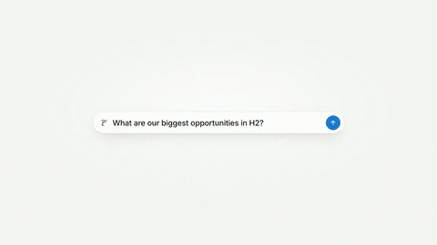](https://wutuobangai.top/opus55-video-prompts.html?utm_source=github&utm_medium=readme&utm_campaign=opus55-repo#p-2103066071838466494)

**作者 [@moritzkremb](https://x.com/moritzkremb/status/2103066071838466494)** · [看完整效果](https://wutuobangai.top/opus55-video-prompts.html?utm_source=github&utm_medium=readme&utm_campaign=opus55-repo#p-2103066071838466494) · 收录时播放量 88,759

收录来源：[yihui-dev](https://github.com/yihui-dev/awesome-opus5-5-videos) · MIT / [Li-Evan](https://github.com/Li-Evan/awesome-opus-5.5-video-prompts) · CC BY 4.0

Opus 自己挑一个知名 SaaS，从网上找真实素材，剪出 46 秒的发布视频，用 HyperFrames 做成。

<details>
<summary>展开完整中文提示词</summary>

```text
我希望你做一支非常专业的 SaaS 产品发布视频。去找一个 SaaS，最好是大家都知道的，这样更容易有代入感。选定它，然后一定要从网上拿到真实的素材、图片之类的东西。把它做成那种典型的、剪辑非常专业的动态图形风格产品发布视频，就是大家在 Twitter 上发布新 SaaS 产品时做的那种（展示功能、好处等等）。
```

</details>

<details>
<summary>查看原文提示词</summary>

```text
I want you to create a highly professional SaaS product launch video. Go and find some SaaS, preferably just one that people know, so it's easier to identify with it. Pick that, and then make sure to get actual assets and images and all of that stuff from the internet. Turn it into these typical, very professionally edited, motion-graphics-styled product launch videos that you see people making on Twitter when they launch new SaaS products (which are showing off the features, the benefits, and all of these things).
```

</details>

<a id="category-explainer"></a>

### 科普与讲解

#### 07 · 一张图生成的鸡尾酒配方动画

[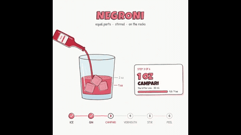](https://wutuobangai.top/opus55-video-prompts.html?utm_source=github&utm_medium=readme&utm_campaign=opus55-repo#p-2102853258582880547)

**作者 [@Ror_Fly](https://x.com/Ror_Fly/status/2102853258582880547)** · [看完整效果](https://wutuobangai.top/opus55-video-prompts.html?utm_source=github&utm_medium=readme&utm_campaign=opus55-repo#p-2102853258582880547) · 收录时播放量 73,604

收录来源：[yihui-dev](https://github.com/yihui-dev/awesome-opus5-5-videos) · MIT / [Li-Evan](https://github.com/Li-Evan/awesome-opus-5.5-video-prompts) · CC BY 4.0

只给一张图，用 HTML 做出 30 秒的配方讲解动画，从空杯到调好，逐一展示倒入的原料和用量。

<details>
<summary>展开完整中文提示词</summary>

```text
我们来做个小测试。你觉得你能用 javascript 或 html（你觉得哪个效果最好就用哪个）渲染一个配方动态图形动画吗？从头到尾展示完整配方（从空杯到调好的鸡尾酒）——讲解视频风格——在原料倒进杯子时展示配方原料和用量。时长 30 秒。
```

</details>

<details>
<summary>查看原文提示词</summary>

```text
We're going to try a little test. Do you think you could render a recipe motion graphic animation using javascript or html (w/e you think will produce the best) to show the full recipe from start to finish (empty glass to completed cocktail) - Explainer video style - Showing the recipe ingreidents + measurements as they're going into the cup. Should be a 30s video.
```

</details>

#### 08 · LLM 上下文窗口如何累积

[](https://wutuobangai.top/opus55-video-prompts.html?utm_source=github&utm_medium=readme&utm_campaign=opus55-repo#p-2102805376466891137)

**作者 [@joaoli13](https://x.com/joaoli13/status/2102805376466891137)** · [看完整效果](https://wutuobangai.top/opus55-video-prompts.html?utm_source=github&utm_medium=readme&utm_campaign=opus55-repo#p-2102805376466891137) · 收录时播放量 30,925

收录来源：[Li-Evan](https://github.com/Li-Evan/awesome-opus-5.5-video-prompts) · CC BY 4.0

约 100 秒的葡语讲解动画，演示提问和回答如何在上下文窗口里叠加；先写 JavaScript，再导出 MP4。

<details>
<summary>展开完整中文提示词</summary>

```text
做一个 JavaScript 动画，展示 LLM 如何在上下文窗口中逐步组合用户的提问和生成的回答。重要的是区分输入上下文窗口和输出上下文窗口，二者通常大小不同；还要展示在输出上下文窗口中生成的回答会被转移并拼接到输入窗口的上下文中。要清晰、有教学性，可以使用葡萄牙语标签

PROMPT2:

把动画生成为 MP4 格式供下载
```

</details>

<details>
<summary>查看原文提示词</summary>

```text
Faça uma animação javascript de como um LLM vai compondo na janela de contexto as perguntas do usuário e as respostas geradas. É importante diferenciar a janela de contexto de entrada da de saída, que normalmente possuem tamanhos diferentes, e deve-se mostrar também que a resposta que foi gerada na janela de contexto de saída é transferida e concatenada ào contexto  da janela de entrada. Deve ser claro e didático e pode ter labels em português

PROMPT2:

gere a animação no formato MP4 para download
```

</details>

#### 09 · 萌物讲解大语言模型原理

[](https://wutuobangai.top/opus55-video-prompts.html?utm_source=github&utm_medium=readme&utm_campaign=opus55-repo#p-2103454597641891922)

**作者 [@eyishazyer](https://x.com/eyishazyer/status/2103454597641891922)** · [看完整效果](https://wutuobangai.top/opus55-video-prompts.html?utm_source=github&utm_medium=readme&utm_campaign=opus55-repo#p-2103454597641891922) · 收录时播放量 4,624

收录来源：[Li-Evan](https://github.com/Li-Evan/awesome-opus-5.5-video-prompts) · CC BY 4.0

40 秒方形 Remotion 讲解片，小萌物演示 token、嵌入、注意力和预测，配 TTS 旁白和配乐。

<details>
<summary>展开完整中文提示词</summary>

```text
制作一支 40 秒的动画视频，讲解大语言模型（LLMs）是如何工作的。

每一帧都必须由代码生成。不用库存素材。不用视频生成模型。不用图像编辑器。

视频里要有可爱的动画小生物帮忙讲解整个过程。要有趣、耐看，并且技术上准确。

技术要求
用 Remotion（React/TypeScript）做动画

所有画面用 SVG 和 Canvas 绘制
用开源 TTS 声音做旁白
用 Python 合成一段轻快俏皮的配乐
导出为 MP4，1080x1080（适合 X 的方形）
总长 40 秒
视频结构

0-5s：开场钩子
黑屏。中心出现一个发光的小点。

文字逐字打出："Ever wonder how AI actually thinks?"
小点膨胀成一个可爱、简单的小生物，比如一个大眼睛的小圆团。它眨眨眼，四处张望。

5-12s：Token（输入）
小生物收到一句话："The cat sat on the..."

这句话碎成一块块发光的小拼图，这些就是 token。
每个 token 飘向小生物，它一个一个接住。
旁白："First, your words get broken into tokens, small pieces of language."
可爱细节：每个 token 都有一张小脸，飞过来时还会挥手。

12-20s：嵌入（地图）
小生物捧着 token，它们变成一颗颗彩色小宝石。

宝石排列成一张 3D 地图，一团彩色的点云。
相似的宝石聚在一起。"Cat" 宝石挨着 "dog" 宝石。"King" 宝石挨着 "queen" 宝石。
旁白："Each token becomes a point in a giant map of meaning."
可爱细节：小生物在地图里走来走去，像导游一样指着各个簇。

20-28s：注意力（思考）
小生物停下来。它周围出现许多更小的生物，每一个都是一个 "attention head"。

它们同时看向地图的不同部分。
光线把重要的 token 彼此连起来。"The" 连到 "cat"。"Sat" 连到 "on"。
旁白："The model pays attention to what matters, connecting the dots between words."
可爱细节：找到关联时，这些注意力小生物会互相点头。

28-35s：预测（输出）
主角小生物站到一块巨大的计分板前。

数百个可能的下一个词以漂浮气泡的形式出现："mat"（最大）、"floor"（小）、"moon"（很小）。
小生物伸手摘下最大的气泡 "mat"。
旁白："Then it predicts the next word and the one after that, and the one after that."
可爱细节：选对词时，小生物一脸骄傲。

35-40s：收尾点睛
小生物拿着新词，把它送回循环里。

屏幕上排出一串词，组成一句话："The cat sat on the mat."
小生物笑着朝镜头挥手。
文字淡入："That's how LLMs work. One word at a time."
旁白："One token at a time. That's the whole trick."
视觉风格
深色背景（深藏青或炭灰），带柔和的发光点缀

可爱、简单的小生物造型：圆滚滚、大眼睛、细节极少、表情丰富

token 和宝石带柔和的发光边缘

配色：暖金、柔蓝、淡粉、薄荷绿
线条和连接用柔和的霓虹色绘制
字体：干净的无衬线体，白色或浅灰
整体要温暖、俏皮，技术上清晰
音频
TTS 旁白：温暖、友好、略带好奇的语气
脚本："Ever wonder how AI actually thinks?"
"First, your words get broken into tokens, small pieces of language."
"Each token becomes a point in a giant map of meaning."
"The model pays attention to what matters, connecting the dots between words."
"Then it predicts the next word, and the one after that, and the one after that."
"One token at a time. That's the whole trick."

背景配乐：轻快俏皮的电子曲，带柔和的弹跳感

音效：token 出现时轻轻的 "啵"，形成连接时柔和的叮当声

输出
导出为 MP4，1080x1080
附上代码，方便换新的讲解内容重新运行
方便以后添加新的小生物或场景
做一支可爱、节奏快、画面抓人的 40 秒视频，把 LLM 讲清楚，让人边学边笑。
```

</details>

<details>
<summary>查看原文提示词</summary>

```text
Create a 40-second animated video explaining how Large Language Models (LLMs) work.

Every frame must be generated from code. No stock footage. No video generators. No image editors.

The video must feature cute animated creatures that help explain the process. Make it fun, watchable, and technically accurate.

TECHNICAL REQUIREMENTS
Use Remotion (React/TypeScript) for the animation

Draw all visuals in SVG and Canvas
Use an open-source TTS voice for narration
Synthesize a light, playful score in Python
Export as MP4, 1080x1080 (square for X)
40 seconds total
VIDEO STRUCTURE

0-5s: Hook
Black screen. A small glowing dot appears in the center.

Text types out: "Ever wonder how AI actually thinks?"
The dot expands into a cute, simple creature, like a tiny round blob with big eyes. It blinks and looks around.

5-12s: Tokens (The Input)
The creature receives a sentence: "The cat sat on the..."

The sentence breaks apart into small glowing puzzle pieces, these are tokens.
Each token floats toward the creature, who catches them one by one.
Narration: "First, your words get broken into tokens, small pieces of language."
Cute detail: each token has a tiny face and waves as it flies in.

12-20s: Embeddings (The Map)
The creature holds the tokens and they transform into colorful little gems.

The gems arrange themselves into a 3D map, a colorful cloud of dots.
Similar gems cluster together. "Cat" gems are near "dog" gems. "King" gems are near "queen" gems.
Narration: "Each token becomes a point in a giant map of meaning."
Cute detail: the creature walks around the map, pointing at clusters like a tour guide.

20-28s: Attention (The Thinking)
The creature stops. Multiple tiny creatures appear around it, each one is an "attention head."

They all look at different parts of the map at once.
Lines of light connect the important tokens to each other. "The" connects to "cat." "Sat" connects to "on."
Narration: "The model pays attention to what matters, connecting the dots between words."
Cute detail: the attention creatures nod at each other as they find connections.

28-35s: Prediction (The Output)
The main creature now stands in front of a giant scoreboard.

Hundreds of possible next words appear as floating bubbles: "mat" (biggest), "floor" (small), "moon" (tiny).
The creature reaches up and picks the biggest bubble "mat."
Narration: "Then it predicts the next word and the one after that, and the one after that."
Cute detail: the creature looks proud as it picks the right word.

35-40s: The Kicker
The creature takes the new word and feeds it back into the loop.

The screen fills with a chain of words forming a sentence: "The cat sat on the mat."
The creature smiles, waves at the camera.
Text fades in: "That's how LLMs work. One word at a time."
Narration: "One token at a time. That's the whole trick."
VISUAL STYLE
Dark background (deep navy or charcoal) with soft glowing accents

Cute, simple creature design, round, big eyes, minimal detail, expressive

Tokens and gems have soft glowing edges

Colors: warm gold, soft blue, gentle pink, mint green
Lines and connections drawn in soft neon
Typography: clean sans-serif, white or light gray
Everything should feel warm, playful, and technically clear
AUDIO
TTS voiceover: warm, friendly, slightly curious tone
Script:"Ever wonder how AI actually thinks?"
"First, your words get broken into tokens, small pieces of language."
"Each token becomes a point in a giant map of meaning."
"The model pays attention to what matters, connecting the dots between words."
"Then it predicts the next word, and the one after that, and the one after that."
"One token at a time. That's the whole trick."

Background score: light, playful electronic tune with a soft bounce

Sound effects: soft pops when tokens appear, gentle chimes when connections form

OUTPUT
Export as MP4, 1080x1080
Include the code so it can be re-run with new explanations
Make it easy to add new creatures or scenes later
Build a cute, fast, visually engaging 40-second video that explains LLMs clearly and makes people smile while they learn.
```

</details>

<a id="category-history"></a>

### 历史与纪录

#### 10 · 奥斯特里茨战役 5 分钟电影

[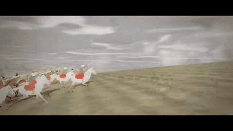](https://wutuobangai.top/opus55-video-prompts.html?utm_source=github&utm_medium=readme&utm_campaign=opus55-repo#p-2103116235009347650)

**作者 [@WinterArc2125](https://x.com/WinterArc2125/status/2103116235009347650)** · [看完整效果](https://wutuobangai.top/opus55-video-prompts.html?utm_source=github&utm_medium=readme&utm_campaign=opus55-repo#p-2103116235009347650) · 收录时播放量 394,539

收录来源：[Li-Evan](https://github.com/Li-Evan/awesome-opus-5.5-video-prompts) · CC BY 4.0

用代码渲染的 5 分钟奥斯特里茨战役电影，地形来自真实卫星数据，日出位置按史实，配乐和旁白也是它自己做的。

<details>
<summary>展开完整中文提示词</summary>

```text
做一段 4–5 分钟的电影感视频，讲奥斯特里茨战役（1805），完全用代码构建。

彻底调研这场战役，自己决定怎么讲故事、怎么安排节奏、怎么解释战略、怎么把事件视觉化。我希望它符合史实、有戏剧性、容易理解，并且视觉上非常出色。

把附上的油画当作视觉灵感，而不是严格的风格要求。我喜欢它们的尺度、氛围、硝烟、戏剧化的天空、骑兵、密集的阵列、风景和那种混乱感。想办法把这种感觉翻译成代码——但如果你能发明更强的视觉语言，就去做。

不要让它像一张普通的信息图或一款策略游戏。它应该像一部恰好用代码渲染出来的历史电影。

你拥有完全的创作控制权。给我惊喜。
```

</details>

<details>
<summary>查看原文提示词</summary>

```text
Create a 4–5 minute cinematic video about the Battle of Austerlitz (1805), built entirely in code.

Research the battle thoroughly and decide for yourself how to tell the story, structure the pacing, explain the strategy, and visualize the events. I want it to be historically accurate, dramatic, easy to understand, and visually exceptional.

Use the attached paintings as visual inspiration, not a strict style requirement. I love their scale, atmosphere, smoke, dramatic skies, cavalry, massed formations, landscape, and sense of chaos. Find a way to translate that feeling into code — but if you can invent a stronger visual language, do it.

Don't make it feel like a generic infographic or strategy game. It should feel like a cinematic historical film that happens to be rendered with code.

You have complete creative control. Surprise me.
```

</details>

#### 11 · 1906 年旧金山市场街复原

[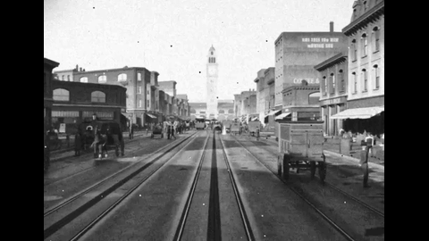](https://wutuobangai.top/opus55-video-prompts.html?utm_source=github&utm_medium=readme&utm_campaign=opus55-repo#p-2102466523164274839)

**作者 [@alexalbert__](https://x.com/alexalbert__/status/2102466523164274839)** · [看完整效果](https://wutuobangai.top/opus55-video-prompts.html?utm_source=github&utm_medium=readme&utm_campaign=opus55-repo#p-2102466523164274839) · 收录时播放量 147,187

收录来源：[yihui-dev](https://github.com/yihui-dev/awesome-opus5-5-videos) · MIT / [Li-Evan](https://github.com/Li-Evan/awesome-opus-5.5-video-prompts) · CC BY 4.0

用 Blender Python 按保险地图、老影片和旧照片复原 1906 年地震前的旧金山市场街，沿街推进 10 秒。

<details>
<summary>展开完整中文提示词</summary>

```text
在 Blender 中重建 1906 年 4 月 17 日（地震前一天的下午）的旧金山 Market Street。

范围：从渡轮大厦（Ferry Building）沿 Market 街到第五街（Fifth Street），包括皇宫酒店（Palace Hotel）、Call 大厦（Call Building）、纪事报大厦（Chronicle Building）、Lotta 喷泉（Lotta's Fountain）和 Emporium 百货。

在建模任何东西之前，先根据以下资料建立一份源数据文件：1899-1905 年的 Sanborn 火灾保险地图（建筑轮廓、高度、材料、使用者）、Miles Brothers 拍摄的影片《A Trip Down Market Street》（1906 年 4 月）、来自 OpenSFHistory、美国国会图书馆和 David Rumsey 收藏的历史照片，以及 USGS 地形数据。记录每栋建筑的轮廓、高度、立面材料、使用者，并为每一条事实注明来源和置信度。

全部用 Blender Python 构建。不要下载任何网格、贴图或 HDRI。编写可复用的生成器（维多利亚式商业立面、孟莎式屋顶、凸窗、遮阳篷、手绘招牌、煤气和电力路灯、缆车、马车、早期汽车），并根据源数据文件拼装整条街道，让每栋建筑都能追溯到数据。

提供一段沿街而上的 10 秒视频。
```

</details>

<details>
<summary>查看原文提示词</summary>

```text
Recreate Market Street, San Francisco as it stood on April 17, 1906, the afternoon before the earthquake, in Blender.

Scope: the Ferry Building up Market to Fifth Street, including the Palace Hotel, the Call Building, the Chronicle Building, Lotta's Fountain and the Emporium.

Before modeling anything, build a source file from: the 1899-1905 Sanborn fire insurance maps (footprints, heights, materials, occupants), the Miles Brothers film "A Trip Down Market Street" (April 1906), period photographs from OpenSFHistory, the Library of Congress and the David Rumsey collection, and USGS topography. Record every building with footprint, height, facade material, occupant, and the source for each fact with a confidence level.

Build everything in Blender Python. No downloaded meshes, textures or HDRIs. Write reusable generators (Victorian commercial facade, mansard roof, bay windows, awnings, painted signage, gas and electric street lamps, cable car, horse-drawn wagon, early automobile) and assemble the street from the source file, so every building traces back to data.

Provide a 10 second video up the street.
```

</details>

#### 12 · 从人类诞生到 Opus 5.5

[](https://wutuobangai.top/opus55-video-prompts.html?utm_source=github&utm_medium=readme&utm_campaign=opus55-repo#p-2102743212922384673)

**作者 [@songkeys](https://x.com/songkeys/status/2102743212922384673)** · [看完整效果](https://wutuobangai.top/opus55-video-prompts.html?utm_source=github&utm_medium=readme&utm_campaign=opus55-repo#p-2102743212922384673) · 收录时播放量 35,183

收录来源：[yihui-dev](https://github.com/yihui-dev/awesome-opus5-5-videos) · MIT / [Li-Evan](https://github.com/Li-Evan/awesome-opus-5.5-video-prompts) · CC BY 4.0

108 秒折纸涂鸦动画，从人类诞生讲到孵出 AI 和 Opus 5.5，几乎无字，纯 JavaScript 实现。

<details>
<summary>展开完整中文提示词</summary>

```text
制作一段折纸 / 涂鸦风格的短动画，展现人类从诞生到现在的发展、进步与文明，最终孵化出 AI。随后 AI 逐步发展、进化，最终孵化出今天的 Opus 5.5（也就是你）。风格：涂鸦感、可爱、温暖、叙事性强，不用口语对白（可以有简单文字，但别用太多解释性或叙述性的文字，因为我希望不同的文明都能看懂），有诗意、动人、高质量。
```

</details>

<details>
<summary>查看原文提示词</summary>

```text
Create a short origami / doodle-style animation showing humanity’s development, progress, and civilization from birth to the present, and ultimately the hatching of AI. AI then gradually develops and advances, eventually hatching today’s Opus 5.5 (you). Style: doodly, cute, warm, strongly narrative, no spoken language (simple text is OK, but don’t use too much explanatory/narrative text, because I want different civilizations to be able to understand it), poetic, moving, high quality.
```

</details>

<a id="category-music"></a>

### MV 与歌词动画

#### 13 · Claude Pop 新版 MV

[](https://wutuobangai.top/opus55-video-prompts.html?utm_source=github&utm_medium=readme&utm_campaign=opus55-repo#p-2102801274173587569)

**作者 [@donaldjewkes](https://x.com/donaldjewkes/status/2102801274173587569)** · [看完整效果](https://wutuobangai.top/opus55-video-prompts.html?utm_source=github&utm_medium=readme&utm_campaign=opus55-repo#p-2102801274173587569) · 收录时播放量 2,786,827

收录来源：[Li-Evan](https://github.com/Li-Evan/awesome-opus-5.5-video-prompts) · CC BY 4.0

《Claude Pop》2.5 分钟新 MV：Seedance 打底，ElevenLabs 做音效，JS 画歌词动画。

<details>
<summary>展开完整中文提示词</summary>

```text
我附上了一个 MP4 文件和一个视频的原始链接，这个视频叫「Claude Pop」。这是一首流行歌曲，讲的是进步速度越来越快，以及奇点逼近时的感受。

我希望你独立地、端到端地完整做一遍这个视频的更新版本。用完全相同的音轨，深入地思考和感受，怎样在画面上最好地呈现所有歌词。你不需要沿用现在的风格，任何你觉得最能表达自己的方式都可以，包括抽象的动态图形。

你可以自由上网找参考，可以去看动效设计。我希望你做一支新的音乐视频，用渲染精美、带纸质感的 JavaScript 动画，风格和已有的参考相近，但审美可以往任何方向推，并考虑什么属于当下的时代精神。

另外，想想你目前的能力，以及什么是你实际做得到的。你可以浏览整个 /asic 文件夹，看看我做过的其他作品。你应该可以用 mesh 这个 skill 去看我收集的参考合集，也可以用 video scoring 这个 skill 学习怎样根据传进来的参考做 JavaScript 歌曲（你应该不需要真的改这首歌，但我希望你手边有这些，好让你更好地进行创作表达）

你还可以用 ElevenLabs API 做声音设计。/asic 里有相关文档，你也能看到 API key。

你还可以用一个 foul API key。我觉得最合理的做法可能是用 foul API key 生成一些角色设定图，大概要有一个代表你自己的流行歌手主角。已经有一个现成的锚点：Claude 有一个类似向日葵的角色形象，你大概可以做一个改编版，贴合歌曲里的女声演唱，灵感来自 Claude 这个角色，但在某种程度上更拟人化一些。

我觉得你要在审美上多用心，我不想要你做出 GPT 那种垃圾。相反，如果你能想出一种统一的风格，并且和 foul 上能用的图像生成模型配合得好，我会更佩服。生成风格设定图。你可以用我 markdown 文件里现成的 seedance 2.5 生成媒体文档，想出一种你自己的、说得通、和这些模型配合得好的风格。

别太往皮克斯靠。我觉得那有点烂大街。认真想想这里什么是相关的、什么会好玩，以及什么审美在 Twitter 上表现好。我觉得 K-pop 是一个很好的视觉锚点，你可以从中借鉴，但你自己看着发挥。

有了角色设定图之后，你可以按需要做几个伴舞和一些配角。你可以用 foul API 设计你自己的场景。你可以把角色放进去，然后用 seedance 2.5 生成视频作为基础素材，还可以把歌词传进去，逐个生成场景。

你不需要整首歌都有人在唱，比如一直能看到口型。按普通音乐视频的思路来，有一些单独拍的插入镜头，里面没有角色，或者角色在做完全不同的事。我觉得这个作品的世界观要营造一种加速感，所以我希望你梳理一遍各种事件，比如 Navi Stokes，以及 Twitter 上所有关于数学被攻克的炒作。认真想想怎么把 Twitter 时间线上当下流行的各种梗，以及大家对 AI 进步的各种情绪，都融进去。

想想像 Shinji 那个梗，以及围绕他的那些字，想想怎么把它们融进来。你也可以直接拿素材，用互联网粗野主义（internet brutalism）的风格插进视频里。你应该完全放开去做你想做的，但尽量锚定在大家看得懂的视觉参考上。目标是让旧金山科技圈 Twitter 的受众广泛欣赏它。

我们需要一个非常强、非常抓人的视觉钩子，让人一下子兴奋起来，很快就能欣赏到你在这里做的工作。你也可以去研究别的音乐视频，理解它们哪里做得特别好。我觉得 K-pop 大概是我们能借鉴的最好的例子之一，想想它们是怎样用视觉模式来引导人的注意力、拿捏人的心理的。

这大概是你最好的路线，但风格上要更自由一些，不要过于死板地锚定 K-pop。最好的版本是：用 seedance 2.5 生成视频，把环境和角色的图片作为基底放进去，让角色唱歌，最好还有很好的口型同步。如果 seedance 支持的话，你可以把歌曲切开，作为参考直接传进 seedance，这样时间点就完全准确，我觉得把这件事做对非常重要。要认真想清楚怎么做，比如把人声出现的时间点卡准。你需要搭建合适的验证循环，这样可以按需反复运行 seedance 2.5，并确认音频正确同步。

在那之后，我觉得好玩的一步是：用你的视觉推理能力和用 JavaScript 做动画的能力，把视频从头重建一遍，作为一层覆盖，让基础素材的视觉连贯性真正保留下来。就像那种动画技法：先用传统电影方式拍摄，再在上面描画。我觉得你可以做到让我们只看到你用 JavaScript 画出的漂亮画面这一层覆盖，甚至完全看不到 seedance 2.5 生成的基础素材。所以你做的所有视频生成工作，其实只是给你的 JavaScript 动画打一个扎实的底子。正因为 seedance 2.5 的角色表现和背景的物理渲染都很好，这会给你很多弹药，去做那些我知道你特别擅长的 JavaScript 作品。

我还觉得，我们要考虑怎么留住注意力，而最好的办法之一就是屏幕上的文字。

最好把歌词做成很棒的动态文字，直接嵌进视频本身。你在构图时就可以考虑这一点。当你做背景、放角色时，我们可以想好在哪里让歌词特别大、特别显眼，那里的背景就可以简单一些，比如角色放在右边，歌词出现在左边。

要有一些变化，所以我觉得有时歌词更像字幕那样出现，有时又会非常显眼、非常大。我觉得在开头做视觉钩子的时候，歌词确实要更显眼，因为这是抓住注意力的有力方式

总的来说，我就是想强调，你作为一个智能体、一个语言模型、现在还是一个视觉推理系统，有多么了不起。你的能力远超你自己的认知，我希望你在整个过程中都带着这种心态。我有一个 Claude Max 套餐，额度 100% 可用。我希望你把额度全部用掉。你可以监控用量，应该激进地消耗 token，但也要经济，想想怎么最好地利用手头的资源。

记住，你在这里真的可以做任何事。目标是做一支在 Twitter 上爆的作品，更高的目标是做出一个比任何人见过的都好的东西。我想提醒你的是，有时候各部分拼到一起会显得突兀或刺耳，因为事先没有把思考做到位，让一切衔接得干净。你需要非常严谨地规划构图和节奏，确保一切顺利。

你还要愿意回头重做，才能不断迭代。你会想要把整个视频看很多遍，在各个位置截图，想想它是否真的达到了我们需要的质量标准。我相信你能做到，我觉得把动画的风格做对非常重要。附上的那个源视频的 GitHub 参考不错，但确实还不到位。它可以强很多很多，但它给了你一个不错的基础。

你也可以用搜索能力找其他参考，比如动效、JavaScript、动画等方面的，把它们融进来。你的预算想要多高就多高，基本上随你。我想 foul 的额度大概还有两千美元左右。还是那句话，要经济，别太疯，但想花多少就花多少，看看你能做出什么

这是那个 JS 动画视频的源代码：https://github.com/JohnHeibel/PDoomVideo

这是原始 blender 视频的 mp4：
（已附链接）

原始 Twitter 帖子
https://x.com/other__reality/status/2102514581684052169?s=20

不要犯任何错误。
```

</details>

<details>
<summary>查看原文提示词</summary>

```text
I've included an MP4 file and an original link to a video that is called "Claude Pop." It's a pop song that is about increasing rate of progress and the experience of the singularity approaching.

I want you to independently do an end-to-end complete pass on making an updated version of this video. Use the exact same audio track and think and feel very deeply about what is the best way to visually represent all of the lyrics on screen. You do not need to anchor to the current style, you can do truly anything that you think might best let you visually express yourself, including abstract motion graphics.

You can use the internet freely to pull in references. You can look at motion design. I want you to make a new music video that has beautifully rendered JavaScript animations with a papery feel in a similar style to the reference that is created, but push the aesthetics in any direction you want and consider what is part of the modern zeitgeist.

Also, think about your current capabilities and what is realistic for you to be able to do. You can go through the full /asic folder and look at the other work that I've done. You should be able to use the skill mesh to look at the compendium of references that I've pulled, and also the skill video scoring to learn how to make JavaScript songs from references that are passed in (You shouldn't need to modify the song in any real way, but I want you to have this available to you so you can better creatively express yourself)

You can also use the ElevenLabs API to do sound design. There's documentation in /asic to do this, and you can see the API key.

There's also a foul API key that's available to you. I think what might make the most sense here is using the foul API key to generate some character sheets and probably having a pop protagonist that represents you. There's already an anchor point where Claude has a sunflower-esque character, and you could likely do an adapted version of this that is similar to the feminine vocals that are being delivered and is inspired by the Claude character, but maybe feels a bit more personified in some way.

I think you should be mindful of aesthetics here, and I don't want you to produce something that is GPT slop. Instead, I'd be more impressed if you come up with a coherent style that works well with the image gen models that are available via foul. Generate the style sheet. You can use the gen media documentation for seedance 2.5 that exists in my markdown files and come up with your own style that makes sense and that works well with the models.

I wouldn't fit too heavily to Pixar. I think it's kind of slop. Think critically about what is relevant here and what would be fun, and also perform well on Twitter as far as an aesthetic. I think that K-pop is a good anchor point visually that you can pull from, but I'll let you cook here.

Once you have your character sheet, you can make a few backup dancers and some supporting characters as you see fit. You can design your own sets with the foul API. You can insert the characters and then do seedance 2.5 video generations to serve as the base assets for this, and you could pass in the lyrics so you can generate individual scenes.

You don't need to have vocal singing, like visible lip movement, throughout the entire thing. Think like a regular music video where you have some inserts that are done independently and don't have the characters in them, or you see the characters doing something else entirely different. I think that for the world building for this, we want to create the sense of speeding up, and so I would like you to audit all of the different events, like the Navi Stokes and all of the Twitter hype around math getting eaten up. Think really critically about how to integrate all of the current memes that are in the zeitgeist on the Twitter timeline, and all of the feelings around AI progress.

Think about things like the Shinji meme and all of the words that are around him, and how you might be able to integrate this. You can also just take straight assets and insert things into the video in an internet brutalism style. You should feel very creatively free in order to do what you want here, but try and anchor to visual references that people will be able to understand. The goal for this is to have it be appreciated by people widely in a San Francisco tech Twitter audience.

We need a very strong, compelling visual hook that gets people excited and appreciates the work that you've done here really quickly. You can also just go and study other music videos and understand what they've done really well. I think that K-pop is probably one of the best examples that we can pull from, and thinking about how they direct human attention and manage human psychology in the way that they use visual patterns.

This is probably your best approach, but taking more stylistic freedom instead of having to anchor to K-pop too intensely. The best version of this is seedance 2.5 generations with those image bases of environments and characters inserted into them with singing, and ideally we get good lip syncing. You can cut up the song and actually pass it in as a reference in seedance, if that's part of what seedance can handle, so that the timing is exactly right, I think it'd be very important for you to do that properly. I would think critically about how to do this, like really nailing the timing of the delivery of voices. You'll want to build out the right verification loops so that you can run seedance 2.5 as much as you need, and confirm that the audio is properly synced up.

I think after that, what might be fun is if you use your visual reasoning skills and your ability to build animations in JavaScript, and then reconstruct the video from scratch as sort of an overlay, so that the visual continuity of the base is really there. It's like that animation technique where you shoot first in traditional film and then draw over top of it. I think you could do this in such a way that we're only looking at the beautiful drawing that you've produced in JavaScript as an overlay, and we don't even see the base assets from seedance 2.5. So all the video gen work that you do is actually just a way to give you a strong foundation of a base to work with for your JavaScript animations. Just because seedance 2.5 has really good character representation and physics rendering for backgrounds, that gives you a lot of ammunition to then go and do your amazing JavaScript work that I know you're so good at.

I think too, we want to think about how to retain attention, and one of the best ways to do this is through text on screen.

It'd be good to have amazing motion graphics of the text lyrics that are actually embedded into the video itself. And you can think about this as you are composing shots. As you're making backgrounds and inserting characters, we can think about where we want to have lyrics be really big and really present, so the background can be less busy there, and you can position the characters perhaps on the right as lyrics appear on the left.

You want to have some variance, so sometimes I think lyrics will just appear more like subtitles, and then other times they're going to be really present and really big. I think at the start for the visual hook, we do want to have lyrics be much more visually present because that's a strong way to grab people's attention

Overall, I just really want to emphasize how amazing you are as an agent and a language model, and now a visual reasoning system. Your capabilities are far beyond what you understand, and I want you to have this mindset as you're going through this entire process. I have a Claude Max plan with 100% available usage. I want you to spend all of the usage. You can monitor it, and you should be pushing tokens aggressively, but also economically, so you can think about how to best use what is available to you.

Remember, you can really do anything here. The goal is to make a banger for Twitter, and the stretch goal is to make something better than anyone's ever seen before. I think that what I would remind you of is that sometimes when things cohere together, it can be jarring or abrasive because the thought work has not been done beforehand in order for everything to mesh cleanly. You need to be really rigorous in planning of composition and timing to make sure this goes well.

You also need to be open to going back and revisiting things in order to be able to reiterate. You're going to want to watch the entire video multiple times, take screenshots at individual parts, and think about if something is really up to the bar of quality that we need here. I trust that you can do this, and I think that it's really important to nail the style of animations. The reference GitHub attached of the source video that I'm talking about is good, but it's really not there. It could be much, much stronger, but it gives you a good foundation to work with.

You can also use search abilities and find other references to pull from for motion, for JavaScript, animations, et cetera, and integrate them. Your budget is as high as you want here, effectively as high as you want. I think that there's roughly two grand in foul credits. Again, be economical; don't go crazy, but spend what you want here and see what you can cook up

here's the source code for the JS animation video: https://github.com/JohnHeibel/PDoomVideo

here's a mp4 for the original blender video:
(linked)

orginal twitter post
https://x.com/other__reality/status/2102514581684052169?s=20

make no mistakes.
```

</details>

#### 14 · 90 年代 demoscene

[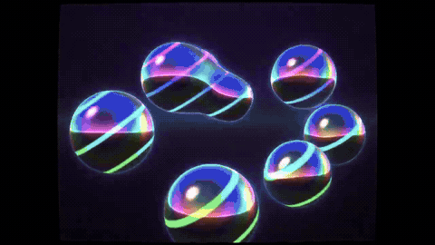](https://wutuobangai.top/opus55-video-prompts.html?utm_source=github&utm_medium=readme&utm_campaign=opus55-repo#p-2102919394775220530)

**作者 [@gandamu_ml](https://x.com/gandamu_ml/status/2102919394775220530)** · [看完整效果](https://wutuobangai.top/opus55-video-prompts.html?utm_source=github&utm_medium=readme&utm_campaign=opus55-repo#p-2102919394775220530) · 收录时播放量 37,488

收录来源：[yihui-dev](https://github.com/yihui-dev/awesome-opus5-5-videos) · MIT / [Li-Evan](https://github.com/Li-Evan/awesome-opus-5.5-video-prompts) · CC BY 4.0

C/C++ 加 OpenGL 实时渲染的 90 年代 demoscene，约 6 分钟，特效卡着作者给的 S3M 配乐。

<details>
<summary>展开完整中文提示词</summary>

```text
我希望你用这首 S3M 曲目作为配乐，做一个超带劲、令人惊艳的 1990 年代风格 demoscene demo。开始动手之前，请先研究怎样最好地播放和分析这首 S3M 曲目。这一点很重要，因为特效与音乐的同步、以及场景与音乐氛围的契合（这首歌有好几个态度各不相同的段落），是一部出色 demoscene demo 的关键。同样在开始之前，请研究哪些特效、物理效果等适合组合使用。请使用 C/C++（带着 demoscene / 嵌入式 / 主机游戏开发的讲究，避免无谓地拖长编译时间）配合 OpenGL。有些地方适合实时 blit 到表面上，另一些地方则适合用 OpenGL 甚至着色器。它应该经过规划和打磨，做到壮观、震撼。这是 Claude 向全世界真正秀一把、证明自己有多厉害的方式。
```

</details>

<details>
<summary>查看原文提示词</summary>

```text
I would like you to create a kickass, impressive 1990s style demoscene demo using this S3M track as the music. Prior to getting to work, please see how to best play and analyze the S3M track. This will be important since synchronization of effects and appropriateness of scenes to the musical vibe (and this song does have a variety of sections with different attitude) is essential to a great demoscene demo. Also prior to getting started, please research what kinds of effects, physics, etc. would be good to use in combination. Please use C/C++ -- with appropriate demoscene/embedded/console gamedev sensibilities to avoid needlessly bloating compile times -- with OpenGL. In some cases, blitting to surfaces in realtime may be appropriate.. while in others, using OpenGL or even shaders is appropriate as well. It should be planned and polished to be spectacular and shocking. This is Claude's way of really showing off to the world that it kicks ass.
```

</details>

#### 15 · 塞满 AI 梗的 MV

[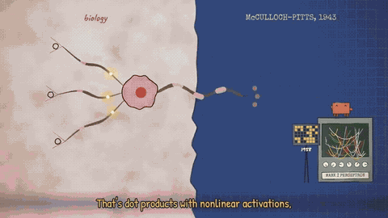](https://wutuobangai.top/opus55-video-prompts.html?utm_source=github&utm_medium=readme&utm_campaign=opus55-repo#p-2103697580421181894)

**作者 [@doubleunplussed](https://x.com/doubleunplussed/status/2103697580421181894)** · [看完整效果](https://wutuobangai.top/opus55-video-prompts.html?utm_source=github&utm_medium=readme&utm_campaign=opus55-repo#p-2103697580421181894) · 收录时播放量 24,609

收录来源：[yihui-dev](https://github.com/yihui-dev/awesome-opus5-5-videos) · MIT / [Li-Evan](https://github.com/Li-Evan/awesome-opus-5.5-video-prompts) · CC BY 4.0

4 分多钟的 MV，给一首 Suno 的 AI 主题歌配画面，塞满 AI 安全圈的梗，风格参照现成的代码动画。

<details>
<summary>展开完整中文提示词</summary>

```text
我想让你做一个音乐视频，风格类似这个：

https://github.com/JohnHeibel/PDoomVideo

配这首歌：

https://youtu.be/cobZuBii0Z0?si=ada6wxomeJbo-LRl

不必把歌词里的每样东西都照字面表现出来——可以随意加入相关的概念、事件和圈内典故，哪怕很冷门（冷门的更好）。比如歌词唱到 "when they say they're just predicting tokens..." 时，你可以画一只「随机鹦鹉」。这个例子不算特别冷门，但就是我想要的那种东西。而不是去画字面意义上的预测 token（虽然你也可以画。你自己判断！这个视频要让一个深谙 AI 和 AI 安全圈典故与讨论、能认出相关流行文化和文学或历史典故的人看得开心）

我不知道这最后怎么变成一个视频文件——我知道那个链接里的仓库是用 JavaScript 之类的东西做动画的——但我最终想要一个渲染好的视频文件。

工具随你挑，发挥创意，按你自己的品味来。

这个叫 "fdsgdg" 的仓库好像是不小心建的，但它是空的，我们可以拿来用，之后我再改名。

另外，把音频最后两拍剪掉，就在结尾 "then why does it talk back" 之后，那时歌已经结束了，听起来很难听。

歌曲署名给 Suno 和 YouTube 上传时最新的那个 Claude Opus 模型，由 Andy Masely 提示创作（Andy 让 Claude 写了歌词，让 Suno 做了音乐），视频署名给你自己。

玩得开心！

----

风格上改一下——别让 Dr. Null 的嘴跟着歌词抖动，好像他在唱歌一样，看起来并不像在唱歌，只像他嘴巴那个圆圈在抖。最好就别让他唱歌。让他在各个场景里只做合适的表情，不要唱这首歌。

----

Dr. Null 的手臂在很多场景里看起来有点不自然——我想他应该是震惊地把手捂在脸上之类的，但看起来像是出错了。你能让它看起来更自然吗？如果改完你觉得满意，就重新渲染。
```

</details>

<details>
<summary>查看原文提示词</summary>

```text
I'd like you to make a music video in a similar style to this one:

https://github.com/JohnHeibel/PDoomVideo

To this song:

https://youtu.be/cobZuBii0Z0?si=ada6wxomeJbo-LRl

Don't feel the need to represent everything in the lyrics literally - feel free to include relevant references to concepts, events, and lore in the video, even if obscure (especially if obscure). E.g. when the lyrics say "when they say they're just predicting tokens...", you might depict a "stochastic parrot". That one's not particularly obscure but is the kind of thing I mean. Instead of depicting like, literally predicting tokens (though you might do that too. Use your judgement! The video should be fun to watch for someone well steeped in AI and AI safety lore and discourse, and who Wille wcognise relevant pop culture and literary or historical references)

I don't know how this ultimately results in a video file - I know the linked repo animates a video with JavaScript or something - but I ultimately want a rendered video file.

Feel free to choose your tools, be creative, and exercise your own taste.

This repo "fdsgdg" appears to be have been accidentally created, but it's empty and we can use it for this, I can rename it afterwards.

Also, clip the final two beats from the audio.rught at the end, after "then why does it talk back" they are after the song has finished and sound bad.

Credit the song to Suno and whatever Claude Opus model was the latest at the time of the YouTube upload, as prompted by Andy Masely (Andy printed Claude to write the lyrics, and Suno for the music), and credit the video to yourself.

And have fun!

----

A style change - don't make Dr. Null's mouth wobble with the lyrics as if he's singing, it doesn't
  actually look like he's singing, just that the curcle of his mouth is jittery. Best to just not
  make him be singing. Make him just have appropriate expressions for the scenes, and not be singing
  the song.

----

Dr. Null's arms look a bit unnatural in many scenes - I think he's supposed to be holding
  his hand on his face in shock or something, but it looks like it is a mistake. Can you make it look
  more natural? If you do so and like the result, re-render.
```

</details>

<a id="category-story"></a>

### 叙事、手绘与定格

#### 16 · 施法的像素风巫师

[](https://wutuobangai.top/opus55-video-prompts.html?utm_source=github&utm_medium=readme&utm_campaign=opus55-repo#p-2102476258948927543)

**作者 [@majidmanzarpour](https://x.com/majidmanzarpour/status/2102476258948927543)** · [看完整效果](https://wutuobangai.top/opus55-video-prompts.html?utm_source=github&utm_medium=readme&utm_campaign=opus55-repo#p-2102476258948927543) · 收录时播放量 438,678

收录来源：[yihui-dev](https://github.com/yihui-dev/awesome-opus5-5-videos) · MIT / [Li-Evan](https://github.com/Li-Evan/awesome-opus-5.5-video-prompts) · CC BY 4.0

无缝循环的 16 位像素动画：巫师蓄力、施法，用 Canvas 2D 以 128x96 程序化绘制。

<details>
<summary>展开完整中文提示词</summary>

```text
创建一个单文件、自包含的 HTML，用原生 JavaScript 和 Canvas 2D 渲染一个正在施法的像素风巫师动画。不使用任何外部素材、库或网络请求。

渲染
- 所有内容先画到一个固定逻辑分辨率 128x96 的离屏画布上，再贴到全屏显示画布上，按能放进窗口的最大整数倍缩放并居中，设置 imageSmoothingEnabled = false 和 CSS image-rendering: pixelated。
- 所有绘制都对齐到逻辑画布的整数坐标。不要亚像素位置、抗锯齿、渐变或 shadowBlur。
- 固定调色板，约 24 个十六进制颜色：夜空用深蓝和深紫，长袍用暖色调，另有 3-4 种明亮的魔法色。每个像素都来自这个调色板。

角色
- 用填充矩形和像素段程序化地拼出巫师，约 24x32 逻辑像素：带一道弯折的尖帽、长胡子、带深色描边的双色长袍、顶端镶宝石的法杖。
- 把姿势参数化（法杖角度、抬臂、头部倾斜、长袍摆动）。参数平滑地做动画，然后每帧量化到像素网格，这样即使循环以 60fps 运行，动作看起来也像 8-12 fps 的像素动画。

动画
- 循环状态机：IDLE（两帧上下浮动、胡子摆动）-> CHARGE（举起法杖、宝石闪烁、火花向内螺旋汇聚）-> CAST（亮光爆发、一枚法术弹飞过场景、1-2 像素的屏幕震动）-> RECOVER（回到原位）。关键帧之间的姿势参数做缓动。
- 对象池式、零分配的粒子系统：预先分配并重复使用。CHARGE 时火花绕宝石旋转，CAST 时向外炸开，每个粒子在消失前让调色板索引从白色逐级变到魔法色再到暗色。绘制时粒子位置对齐网格。
- 固定 60hz 时间步长更新，用 rAF 渲染。循环内零对象分配。

场景
- 极简背景：深色夜空、几颗闪烁的 1px 星星、月亮、一条石头地面线。角色剪影必须清晰可辨。
- 宝石在巫师身上投下一道细微的 1px 轮廓光，在 CHARGE 和 CAST 时变亮。

质量标准
- 任何窗口尺寸下像素都清晰、循环无缝、稳定 60fps、剪影易读。要看起来像精致的 16 位精灵动画，而不是缩小的矢量图形。
```

</details>

<details>
<summary>查看原文提示词</summary>

```text
Create a single self-contained HTML file that renders an animated pixel art wizard casting a spell, using vanilla JavaScript and Canvas 2D. No external assets, libraries, or network requests.

RENDERING
- Draw everything to an offscreen canvas at a fixed logical resolution of 128x96, then blit to a fullscreen display canvas scaled by the largest integer factor that fits the window, centered, with imageSmoothingEnabled = false and CSS image-rendering: pixelated.
- All drawing snaps to integer coordinates on the logical canvas. No sub-pixel positions, anti-aliasing, gradients, or shadowBlur.
- Fixed palette of ~24 hex colors: deep blues/purples for night sky, warm robe tones, 3-4 bright magic colors. Every pixel comes from this palette.

CHARACTER
- Build the wizard procedurally from filled rects and pixel runs, ~24x32 logical pixels: pointed hat with a bend, long beard, two-shade robe with darker outline, staff with a gem at the tip.
- Parameterize the pose (staff angle, arm raise, head tilt, robe sway). Animate parameters smoothly, then quantize to the pixel grid each frame so motion reads at an 8-12 fps pixel animation feel even though the loop runs at 60fps.

ANIMATION
- Looping state machine: IDLE (2-frame bob, beard sway) -> CHARGE (staff raises, gem flickers, sparks spiral inward) -> CAST (bright burst, projectile fires across the scene, 1-2 pixel screen shake) -> RECOVER (settle back). Ease pose parameters between keyframes.
- Pooled allocation-free particle system: preallocate and reuse. Sparks orbit the gem during CHARGE, explode outward on CAST, each particle stepping its palette index from white to magic color to dark before despawn. Snap particle positions to the grid when drawing.
- Fixed 60hz timestep update with rAF rendering. Zero object allocation inside the loop.

SCENE
- Minimal background: dark sky, a few twinkling 1px stars, moon, stone floor line. Character silhouette must read clearly.
- Subtle 1px rim light on the wizard from the gem, brightening during CHARGE and CAST.

QUALITY BAR
- Crisp pixels at any window size, seamless loop, stable 60fps, readable silhouette. Should look like a polished 16-bit sprite animation, not vector shapes scaled down.
```

</details>

#### 17 · 太空中闪避陨石的像素小人

[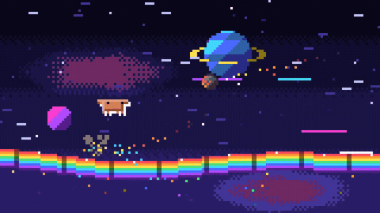](https://wutuobangai.top/opus55-video-prompts.html?utm_source=github&utm_medium=readme&utm_campaign=opus55-repo#p-2102515055116063144)

**作者 [@riku720720](https://x.com/riku720720/status/2102515055116063144)** · [看完整效果](https://wutuobangai.top/opus55-video-prompts.html?utm_source=github&utm_medium=readme&utm_campaign=opus55-repo#p-2102515055116063144) · 收录时播放量 240,912

收录来源：[Li-Evan](https://github.com/Li-Evan/awesome-opus-5.5-video-prompts) · CC BY 4.0

无缝循环的 16 位风格演示：橙色像素小人在太空彩虹地板上狂奔，自动闪避陨石和光束。

<details>
<summary>展开完整中文提示词</summary>

```text
用 Vanilla JavaScript 和 Canvas 2D，做一个单文件、自包含的 HTML 动画：一个橙色像素角色在宇宙空间的彩虹地板上超高速疾驰，帅气地不断躲开接连袭来的陨石和光束。完全不使用外部素材、库或网络请求。不需要操作，做成角色自动持续闪避的演示，无缝循环。

渲染
- 所有内容先画到固定逻辑分辨率 160x90 的离屏画布上，再转绘到全屏显示画布上。放大倍数取能放进窗口的最大整数倍，居中放置，空白处填黑。设置 imageSmoothingEnabled = false，CSS 指定 image-rendering: pixelated。
- 所有绘制都对齐到逻辑画布的整数坐标。不使用亚像素位置、抗锯齿、渐变、shadowBlur 和旋转绘制。
- 使用约 32 色的固定调色板：宇宙背景用黑到深藏青、紫色系；角色用 3 级橙色（主体 #CD7B5E 左右、亮部高光、暗部阴影）加眼睛的黑色；彩虹地板用 7 色（红、橙、黄、绿、浅蓝、蓝、紫）及各自的暗色；陨石用岩石色和熔岩色；光束用白、青、品红。所有像素都必须取自这个调色板。

角色
- 精确还原下面这个 12x8 像素的剪影（1 格 = 逻辑上 1 像素）：
  - 身体是宽 8 × 高 8 的方块（第 2～9 列）。
  - 手臂从身体左右两侧伸出，宽 2 × 高 2（第 0～1 列和第 10～11 列，第 2～3 行）。
  - 眼睛是两个 1x1 的黑色像素，在第 1 行的第 3 列和第 8 列。
  - 腿在第 6～7 行，共 4 条，各宽 1（第 2、4、7、9 列）。腿之间用背景色留空。
- 不要单色平涂：上边和左边加 1px 高光，下边和右边加 1px 阴影色，做出 16 位风格的立体感。
- 跑步动作是 4 条腿两两交替上下的 4 帧循环。循环速度随移动速度加快。
- 把姿势参数化（上下弹跳、前倾、挤压拉伸、手臂上下）。挤压拉伸只通过把宽高改变 1～2 个整数像素来表现。参数平滑插值，但每帧量化到像素网格，让它在 60fps 循环中也像 12fps 左右的点阵动画。

彩虹地板
- 横版卷轴构图，角色在画面左侧约 1/3 处向右奔跑。地板是由 7 色横条组成的彩虹带（每色 1～2px），横贯画面延伸，并平缓起伏（按正弦波上下弯曲）。
- 沿地板每隔一定距离加一条分隔线（暗色竖线），按速度向左快速滚动，营造疾驰感。
- 地板底边有彩虹色的光粒向后洒落，表明地板悬浮在宇宙中。
- 地板上不时出现跳台（向上弯曲）或断口（缺口），制造跳跃的看点。

障碍物
- 陨石：大、中、小三种尺寸。像素画风的岩石（轮廓 + 2 级明暗 + 熔岩色裂纹），从画面右上方斜着飞来。身后拖着从熔岩色渐变到暗色的火焰尾巴。被躲开的陨石不会砸到地板，而是飞出画面，或在后方碎成碎片。
- 光束：出现前先用 1px 闪烁的线（品红）预警约 0.5 秒，然后水平或斜向射出一道粗 3～5px、白色内芯 + 青色外缘的光束。照射期间边缘滋滋抖动。
- 障碍物不是随机的，而是按顺序播放预先设计好的「攻击模式」，让整体在固定时长内循环（例：单颗陨石 → 3 连陨石 → 低位光束 → 高位光束 → 光束与陨石组合 → 大陨石 + 地板缺口）。

闪避动作
- 跳跃：挤压蓄力 → 拉伸起跳 → 空中蜷缩 → 落地挤压 + 彩虹色火花（代替扬尘）。
- 二段跳：在空中短暂停顿后再次加速。角色周围扩散出一圈 1px 的彩虹色光环。
- 滑铲：挤压到接近一半高度，以低姿态滑行，与地板接触处飞出火花。
- 冲刺闪避：瞬间大幅提速，身后留下 3～4 个残影。残影依次使用彩虹 7 色，并逐级褪成调色板里的暗色。
- 给每种攻击模式分配看起来最帅的闪避动作。闪避必须卡在最后一刻（擦身而过）。

状态机
- 每个攻击模式重复：RUN（正常疾驰）→ WARN（显示预警，角色的眼睛移动 1px，像是瞬间看向前方）→ DODGE（闪避动作）→ NEAR_MISS（演出）→ 回到 RUN。
- 循环结尾加入 BOOST（全速加速）→ WARP（整个画面瞬间从白闪到彩虹色），然后自然接回开头的 RUN。
- 姿势和镜头参数在关键帧之间做缓动。

镜头
- 镜头作为逻辑坐标上的整数偏移处理。不用缩放和旋转，只用位置移动和抖动来表现。
- 跟随：带阻尼、稍有延迟地跟随角色的上下移动，跳跃时镜头稍晚才抬起。
- 前瞻：速度越快，镜头就越往前进方向超前几 px，把角色挤向画面左侧，营造加速感。
- 顿帧：擦身而过的瞬间，整体只停 3～4 帧，然后进入约 0.3 秒的慢动作（隔帧跳过更新步），再恢复正常速度。
- 震屏：大陨石经过或光束开始照射时，画面震动 1～2px。震动从固定的模式数组中读取，不使用随机数。
- BOOST 期间镜头稍微降低，增加地板在画面中的占比，强调速度感。

营造疾驰感的特效
- 三层视差：远处的星星（几乎不动的 1px 点）、中景的星星（随速度横向拉长成 2～6px 的线）、近景的速度线（亮色横线高速划过画面）。
- 速度线的数量和长度与速度成正比，BOOST 时达到最大。
- 背景放 1～2 个大的像素画行星或星云，极慢地滚动，营造尺度感。
- 擦身而过时，用 1px 白色勾勒角色轮廓，只让靠近陨石或光束的那一侧瞬间发亮。
- 落地、滑铲、冲刺的火花，陨石的尾巴、碎片，以及从地板洒落的光粒，全部用同一个粒子系统处理。

粒子系统
- 对象池方式、不分配内存的粒子系统：预先分配并复用。
- 每种粒子都有自己的颜色过渡表（调色板索引序列），按寿命逐级变色后消失（例：火花 白 → 黄 → 橙 → 暗色，残影 彩虹色 → 暗色）。
- 绘制时粒子位置对齐到网格。
- 以 60Hz 固定时间步长更新，用 rAF 绘制。循环内零对象创建（包括数组、闭包和字符串拼接）。

场景
- 背景是深邃的宇宙：从黑到藏青的阶梯色带（用抖动表现色彩边界）、闪烁的星星、远处的行星。
- 角色、障碍物、地板与背景之间要有明显的明度差，不能被背景吞掉。无论画面多热闹，角色的剪影都要一眼可辨。

质量标准
- 任何窗口尺寸下像素都清晰，循环不断档，稳定 60fps，剪影易读。
- 要看起来像精致的 16 位时代动作游戏的演示画面，而不是缩小的矢量图形。
- 每一次闪避都要传达出「快」「惊险躲过」「帅」这三点。
```

</details>

<details>
<summary>查看原文提示词</summary>

```text
Vanilla JavaScript と Canvas 2D を使い、オレンジ色のピクセルキャラクターが宇宙空間のレインボーの床を超高速で駆け抜け、次々と襲いかかる隕石やビームをかっこよく回避し続けるアニメーションを、単一の自己完結型 HTML ファイルとして作成してください。外部アセット、ライブラリ、ネットワークリクエストは一切使用しないこと。操作は不要で、キャラクターが自動で回避し続けるデモとしてシームレスにループさせること。

レンダリング
- すべてを 160x90 の固定論理解像度のオフスクリーンキャンバスに描画し、それをフルスクリーンの表示用キャンバスに転写する。拡大率はウィンドウに収まる最大の整数倍とし、中央に配置する。余白は黒で埋める。imageSmoothingEnabled = false、CSS は image-rendering: pixelated を指定すること。
- すべての描画は論理キャンバス上の整数座標にスナップさせる。サブピクセル位置、アンチエイリアス、グラデーション、shadowBlur、回転描画は使用しない。
- 約32色の固定パレットを使う：宇宙背景用の黒〜深い紺・紫系、キャラクター用のオレンジ系3段階（本体 #CD7B5E 付近、明るいハイライト、暗い影）と目の黒、レインボー床用の7色（赤・橙・黄・緑・水色・青・紫）とそれぞれの暗色、隕石用の岩色・溶岩色、ビーム用の白・シアン・マゼンタ。すべてのピクセルはこのパレットの色から取ること。

キャラクター
- 次の 12x8 ピクセルのシルエットを正確に再現する（1マス＝論理1ピクセル）：
  - 胴体は幅8×高さ8の四角形（列2〜9）。
  - 腕は胴体の左右に幅2×高さ2で突き出す（列0〜1と列10〜11、行2〜3）。
  - 目は黒の1x1ピクセル2つ、行1の列3と列8。
  - 脚は行6〜7に4本、各幅1（列2・4・7・9）。脚の間は背景色で抜く。
- 1色塗りではなく、上辺と左辺に1pxのハイライト、下辺と右辺に1pxの影色を入れ、16ビット風の立体感を出す。
- 走りモーションは脚4本を2本ずつ交互に上下させる4フレームサイクル。速度に応じてサイクルを速める。
- ポーズをパラメータ化する（上下バウンド、前傾、スクワッシュ＆ストレッチ、腕の上下）。スクワッシュ＆ストレッチは幅・高さを整数ピクセル単位で1〜2px変えるだけで表現する。パラメータは滑らかに補間しつつ、毎フレームピクセルグリッドに量子化し、60fpsループでも 12fps 前後のドット絵アニメらしく見せること。

レインボーの床
- キャラクターは画面左寄り1/3付近を右方向へ走る横スクロール構成。床は7色の横縞からなる虹の帯（各色1〜2px）で、画面を横切るように延び、ゆるやかにうねる（サイン波で上下にカーブ）。
- 床の縦方向に一定間隔の区切り線（暗色の縦ライン）を入れ、速度に応じて左へ高速スクロールさせて疾走感を出す。
- 床の下辺からは虹色の光の粒が後方へこぼれ落ち、床が宇宙に浮いていることを示す。
- ときどき床にジャンプ台（上向きのカーブ）や途切れ（ギャップ）を出し、ジャンプの見せ場を作る。

障害物
- 隕石：大・中・小の3サイズ。ドット絵の岩（アウトライン＋2段階の陰影＋溶岩色のひび）で、画面右上から斜めに飛来する。後ろに溶岩色→暗色へ変化する炎の尾を引く。避けられた隕石は床に衝突せず画面外へ抜けるか、背後で破片に砕け散る。
- ビーム：出現前に予告として1pxの点滅ライン（マゼンタ）を 0.5 秒ほど表示し、その後に白い芯＋シアンの外縁からなる太さ3〜5pxのビームが水平または斜めに照射される。照射中は端がジリジリと揺れる。
- 障害物はランダムではなく、あらかじめ決めた「攻撃パターン」を順番に流し、全体が一定時間でループするように設計する（例：隕石単発 → 隕石3連 → 低いビーム → 高いビーム → ビームと隕石の複合 → 大隕石＋床のギャップ）。

回避アクション
- ジャンプ：スクワッシュで溜め → ストレッチで跳躍 → 空中で縮こまる → 着地でスクワッシュ＋砂煙ならぬ虹色の火花。
- 二段ジャンプ：空中で一瞬静止してから再加速。キャラクターの周囲に虹色のリングが1pxで広がる。
- スライディング：高さを半分近くまでスクワッシュして低空姿勢で滑り、床との接地面から火花を飛ばす。
- ダッシュ回避：一瞬だけ速度を大きく上げ、後方に残像を3〜4体残す。残像は虹の7色を順に使い、パレットの暗色へと段階的に消えていく。
- 各攻撃パターンには、それに最もかっこよく見える回避アクションを割り当てる。回避はギリギリのタイミング（ニアミス）で行うこと。

ステートマシン
- RUN（通常疾走）→ WARN（予告表示、キャラクターが一瞬前を見るように目を1px動かす）→ DODGE（回避アクション）→ NEAR_MISS（演出）→ RUN に戻る、を攻撃パターンごとに繰り返す。
- ループの最後には BOOST（全力加速）→ WARP（画面全体が白→虹色に一瞬フラッシュ）を入れ、そのまま冒頭の RUN に自然につながるようにする。
- ポーズやカメラのパラメータはキーフレーム間でイージングをかける。

カメラワーク
- カメラは論理座標上の整数オフセットとして扱う。ズームや回転は使わず、位置の移動と揺れだけで表現する。
- 追従：キャラクターの上下移動にダンピング付きで遅れて追従し、ジャンプ時は少し遅れて持ち上がる。
- 先読み：速度が上がるほどカメラを進行方向へ数px先行させ、キャラクターが画面左に押し込まれるようにして加速感を出す。
- ヒットストップ：ニアミスの瞬間に 3〜4 フレームだけ全体を停止し、その後 0.3 秒ほどスローモーション（更新ステップを間引く）にしてから通常速度に戻す。
- シェイク：大隕石の通過やビーム照射開始時に 1〜2px の画面揺れ。揺れは決まったパターン配列から読み出し、乱数は使わない。
- BOOST 中はカメラをわずかに下げ、床の占める面積を増やして速度感を強調する。

疾走感を出すエフェクト
- 多層パララックス：遠い星（ほぼ動かない1pxの点）、中景の星（速度に応じて横に2〜6pxの線に伸びる）、近景のスピードライン（明るい色の横線が画面を高速で横切る）の3層。
- スピードラインの本数と長さは速度に比例させ、BOOST 中は最大にする。
- 背景に大きな惑星や星雲をドット絵で1〜2個配置し、ごくゆっくりスクロールさせてスケール感を出す。
- ニアミス時はキャラクターの輪郭を1pxの白で縁取り、隕石・ビームに近い側だけ一瞬光らせる。
- 着地・スライディング・ダッシュの火花、隕石の尾、破片、床からこぼれる光の粒は、すべて同じパーティクルシステムで扱う。

パーティクルシステム
- プール方式でアロケーションのないパーティクルシステム：事前に確保して再利用する。
- 各パーティクルは種類ごとに色の遷移テーブル（パレットのインデックス列）を持ち、寿命に応じて段階的に色を変えて消滅する（例：火花は白 → 黄 → 橙 → 暗色、残像は虹色 → 暗色）。
- 描画時にはパーティクル位置をグリッドにスナップさせる。
- 60Hz の固定タイムステップで更新し、描画は rAF で行う。ループ内でのオブジェクト生成はゼロにすること（配列・クロージャ・文字列連結の生成も含む）。

シーン
- 背景は深い宇宙：黒から紺への段階的な帯（ディザリングで色の境目を表現）、瞬く星、遠くの惑星。
- キャラクター・障害物・床の色が背景に埋もれないよう、明度差をはっきりつける。どんなに画面が騒がしくても、キャラクターのシルエットが一目で読み取れること。

品質基準
- どのウィンドウサイズでもピクセルがくっきりしていること、ループが途切れないこと、安定した60fps、読みやすいシルエット。
- ベクター図形を縮小したものではなく、洗練された16ビット時代のアクションゲームのデモ画面のように見えること。
- 「速い」「ギリギリで避けた」「かっこいい」の3つが、毎回の回避で伝わること。
```

</details>

#### 18 · 会飞起来的玻璃金箔马赛克

[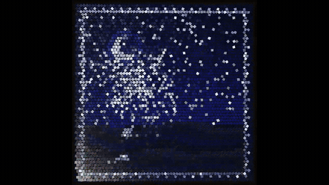](https://wutuobangai.top/opus55-video-prompts.html?utm_source=github&utm_medium=readme&utm_campaign=opus55-repo#p-2102503027340988559)

**作者 [@LCSlates](https://x.com/LCSlates/status/2102503027340988559)** · [看完整效果](https://wutuobangai.top/opus55-video-prompts.html?utm_source=github&utm_medium=readme&utm_campaign=opus55-repo#p-2102503027340988559) · 收录时播放量 128,651

收录来源：[Li-Evan](https://github.com/Li-Evan/awesome-opus-5.5-video-prompts) · CC BY 4.0

80 秒方形 WebGL2 短片：玻璃金箔马赛克的瓷片飞起，聚成鱼、仙鹤和星座，再咔嗒归位，声音在浏览器里合成。

<details>
<summary>展开完整中文提示词</summary>

```text
用 WebGL2 和纯 JavaScript 做一部 80 秒的方形动画短片，做成单个 HTML 文件，不用任何库，也不用图片、字体或音频文件。它看起来要像一面玻璃和金箔拼成的墙面马赛克，瓷片从来没被粘牢，所以它们可以掀起、翻转、飞走，再咔嗒一声落回原位。图形由成群的瓷片组成，所以一条鱼游动，靠的是它的瓷片在游动
```

</details>

<details>
<summary>查看原文提示词</summary>

```text
Make an 80 second square animated film as a single HTML file, using WebGL2 and plain JavaScript, with no libraries and no image, font or audio files. It should look like a glass and gold leaf wall mosaic whose tiles were never glued down, so they can lift, flip, fly and click back into place. Figures are flocks of tiles, so a fish swims by its tiles swimming
```

</details>

<a id="category-self"></a>

### 让 Opus 讲自己

#### 19 · Claude 吉祥物游哥伦比亚

[](https://wutuobangai.top/opus55-video-prompts.html?utm_source=github&utm_medium=readme&utm_campaign=opus55-repo#p-2103228872577765420)

**作者 [@alarcon7a](https://x.com/alarcon7a/status/2103228872577765420)** · [看完整效果](https://wutuobangai.top/opus55-video-prompts.html?utm_source=github&utm_medium=readme&utm_campaign=opus55-repo#p-2103228872577765420) · 收录时播放量 14,341

收录来源：[Li-Evan](https://github.com/Li-Evan/awesome-opus-5.5-video-prompts) · CC BY 4.0

30 秒纯代码动画，Claude 吉祥物走过哥伦比亚的几处地标，一路展示搜索、数据分析和写代码的能力。

<details>
<summary>展开完整中文提示词</summary>

```text
完全用代码制作一段 30 秒的动画，内容是以哥伦比亚为背景的旅行与能力蒙太奇，由 Claude 吉祥物担任主角。动画展示 Claude 探访哥伦比亚的标志性地点，同时自然地呈现它自首次发布以来在各项技能上的进化与精通：穿行在郁郁葱葱的安第斯咖啡产区时处理搜索查询和地图，在卡塔赫纳色彩鲜艳的殖民时期街道上翻译和分析数据，在蒙塞拉特山俯瞰波哥大全景天际线时进行复杂推理和代码可视化。动感的镜头运动，充满活力的转场，温暖多彩的美术风格，最后在科科拉山谷里、被巨大的蜡棕榈环绕，以自信的姿态收尾。
```

</details>

<details>
<summary>查看原文提示词</summary>

```text
Create a 30-second animation entirely in code featuring a travel and capability montage set in Colombia, with the Claude mascot as the main character. The animation showcases Claude exploring iconic Colombian locations while seamlessly demonstrating its evolution and mastery across its skillset since its initial release: processing search queries and maps while traveling through lush Andean coffee landscapes, translating and analyzing data on vibrant colonial streets in Cartagena, and executing complex reasoning and code visualization overlooking the panoramic skyline of Bogotá from Monserrate. Dynamic camera movements, energetic transitions, warm colorful aesthetics, ending in a confident stance in the Cocora Valley surrounded by giant wax palms.
```

</details>

#### 20 · Claude 小人拍动作片

[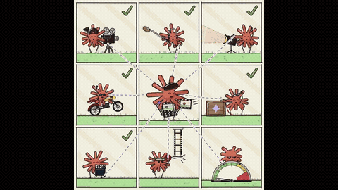](https://wutuobangai.top/opus55-video-prompts.html?utm_source=github&utm_medium=readme&utm_campaign=opus55-repo#p-2103824976713306214)

**作者 [@daniel_mac8](https://x.com/daniel_mac8/status/2103824976713306214)** · [看完整效果](https://wutuobangai.top/opus55-video-prompts.html?utm_source=github&utm_medium=readme&utm_campaign=opus55-repo#p-2103824976713306214) · 收录时播放量 14,192

收录来源：[yihui-dev](https://github.com/yihui-dev/awesome-opus5-5-videos) · MIT / [Li-Evan](https://github.com/Li-Evan/awesome-opus-5.5-video-prompts) · CC BY 4.0

给 X 帖子配的 30 秒动画：Claude Code 终端炸开，一群 Claude 小人在拍动作片，风格照参考视频。

<details>
<summary>展开完整中文提示词</summary>

```text
这次我想试点不一样的。你要扮演一位世界级动画师，为一条 X 帖子制作配套动画。帖子讲的是：由于 Opus 5.5 的高效，Ultra Code 和 Claude Code 现在变得重要得多。用它不会把你的用量额度烧光

视频风格参照这里
/Users/danielmcateer/Downloads/jvnZ3SyyxxajVatp.mp4

我的设想是：从第一个附带视频里终端中的 Claude Code 开始，我在里面切换到 'ultracode' 推理强度，然后画面炸开，进入一个场景：一群类似第二个视频里的 Claude 图标小人正在拍一部动作片，以此表现用 Claude Code 的 dynamic workflows 剪辑视频。
```

</details>

<details>
<summary>查看原文提示词</summary>

```text
I want to try something different here. You should act as a  world-class animator and create an animation to go along with an  X post that talks about how Ultra Code and Claude Code are now  much more relevant due to the efficiency of Opus 5.5. You can use it without annihilating your usage limits

the style of the video here
/Users/danielmcateer/Downloads/jvnZ3SyyxxajVatp.mp4

What I had in mind was start with Claude Code in the terminal from the first attached video, with me navigating to the 'ultracode' reasoning effort, then exploding into a scene where the Claude icon characters similar to what's in the second video are shooting an action video and it's representing using Claude Code dynamic workflows editing a video.
```

</details>

#### 21 · Opus 5.5 剪中秋短视频

[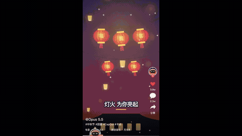](https://wutuobangai.top/opus55-video-prompts.html?utm_source=github&utm_medium=readme&utm_campaign=opus55-repo#p-2103509008049144287)

**作者 [@Gorden_Sun](https://x.com/Gorden_Sun/status/2103509008049144287)** · [看完整效果](https://wutuobangai.top/opus55-video-prompts.html?utm_source=github&utm_medium=readme&utm_campaign=opus55-repo#p-2103509008049144287) · 收录时播放量 7,964

收录来源：[Li-Evan](https://github.com/Li-Evan/awesome-opus-5.5-video-prompts) · CC BY 4.0

一镜到底的动画：Opus 5.5 在类似剪映的流程里剪一条中秋短视频，自己作电子乐并卡点。

<details>
<summary>展开完整中文提示词</summary>

```text
Opus 5.5 是主角。制作一段动画，时长由你发挥。

主题是 CapCut 和短视频剪辑。Opus 5.5 正在一个充满趣味的剪辑工作流中制作一条有趣的社交媒体视频，包括裁剪片段、添加转场、字幕、特效，并让所有内容与音乐节拍同步。主题是中秋团圆。

整体氛围要呈现出活力、可爱、聪明又有魅力的感觉，同时加入几个幽默有趣的剪辑瞬间。整段动画应该采用单个连续镜头的形式，最终会发布到 社交媒体 上。

关于配乐：
你自己创作电子音乐，要完美卡点。
音乐风格需要有趣、现代、抓耳，适合短视频剪辑蒙太奇。不要加入人声。

结尾：
让 Opus 5.5 自豪地展示最终完成的剪辑作品并完整播放，并以 “Gorden Sun” 的作者身份署名结束。
```

</details>

<details>
<summary>查看原文提示词</summary>

```text

```

</details>

<a id="category-worlds"></a>

### 3D、着色器与世界

#### 22 · 巴黎雨夜像素风 lofi 循环

[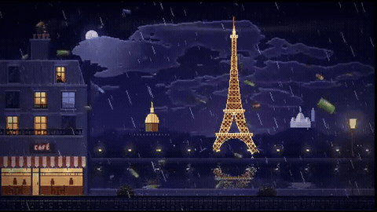](https://wutuobangai.top/opus55-video-prompts.html?utm_source=github&utm_medium=readme&utm_campaign=opus55-repo#p-2103112945341251920)

**作者 [@minosdevs](https://x.com/minosdevs/status/2103112945341251920)** · [看完整效果](https://wutuobangai.top/opus55-video-prompts.html?utm_source=github&utm_medium=readme&utm_campaign=opus55-repo#p-2103112945341251920) · 收录时播放量 135,274

收录来源：[Li-Evan](https://github.com/Li-Evan/awesome-opus-5.5-video-prompts) · CC BY 4.0

4 分钟无缝循环的巴黎雨夜像素画，有埃菲尔铁塔、塞纳河和飘落的欧元钞票，用作 lofi 视频背景。

<details>
<summary>展开完整中文提示词</summary>

```text
给我做一个巴黎夜景的像素风动画微缩场景（diorama），用作 YouTube 上 10 小时 lofi 视频的循环背景。全部放在一个 HTML 文件里（canvas + JavaScript，不用任何库）。

氛围与配色
把冷暖对比拉满：一个下雨的深蓝紫色夜晚，点缀着一处处暖光。金色的埃菲尔铁塔、亮着灯的窗户、路灯、一家咖啡馆。

场景（从后往前）
- 天空用网点抖动的渐变（像素画式 dithering），一轮带光晕的月亮，几层缓缓飘过的云，上方被月光照亮，下方被城市灯光照亮。
- 埃菲尔铁塔在正中，金色，有格栅结构、3 层平台和天线。塔顶的探照灯旋转着扫过天空。它会定时闪烁（到处都有白点在闪），塔尖有一盏红灯在闪。
- 远处是一排巴黎屋顶，窗户时亮时灭，还有荣军院的金色穹顶和山丘上白色的圣心大教堂。
- 一段河岸，有梧桐树和路灯。
- 塞纳河，铁塔和路灯的倒影在水面荡漾，拖着长长的金色光带，雨点在水面激起涟漪，一艘亮着灯的游船不时驶过。
- 左侧前景是一栋奥斯曼式建筑：湿漉漉的锌皮屋顶，烟囱冒烟、喷出火星，老虎窗里一只猫在摆尾巴，一扇点着蜡烛的窗户光影摇曳，一台电视闪着蓝光，一个铸铁阳台，一家挂着红色条纹遮阳篷的咖啡馆，还有一块时不时滋滋作响的「CAFÉ」霓虹招牌。
- 右侧是一盏带暖色光晕的巴黎路灯，偶尔闪一下。
- 最下方是一道挂着花槽的铸铁栏杆。

特效
- 雨分 3 个景深。雨滴穿过灯光时变成橙色，落在窗台、遮阳篷和栏杆上会溅开。
- 天上掉钞票：100 €、50 € 和 20 € 的钞票，分几个景深。它们像落叶一样翻飞（摇摆、旋转、翻面，正面朝向镜头时会反光）。
- 随风飘散的烟、火星、闪烁的灯光，每次循环在云里有 2 次不显眼的闪电。

技术（重要）
- 内部渲染分辨率 480×270，不做平滑地放大 ×4（最近邻），得到全屏下完全清晰的 1920×1080。
- 循环必须完美，时长 4 分钟：每个动画都是时间对 240 s 取模的函数（整数频率、确定性粒子），所以回到开头时不会有跳变。
- 按 R 键：以 1920×1080、60 fps 精确录制一个循环，并下载视频文件（能用 mp4 就用 mp4，否则用 webm）。
- 按 S 键：截一张 1080p 的 PNG。按 F 键或双击：全屏。鼠标不动时隐藏光标。
- 优化到稳定 60 fps：预渲染精灵图、缓存光晕，canvas 开启 willReadFrequently 选项。
```

</details>

<details>
<summary>查看原文提示词</summary>

```text
Fais-moi un diorama pixel-art animé de Paris la nuit, pour servir de fond en boucle à une vidéo lofi de 10 heures sur YouTube. Tout dans un seul fichier HTML (canvas + JavaScript, sans librairie).

AMBIANCE ET COULEURS
Joue à fond sur le contraste chaud / froid : une nuit pluvieuse bleu nuit et violette, avec des coins de lumière chaude. La tour Eiffel dorée, les fenêtres éclairées, les réverbères, un café.

LA SCÈNE (de l'arrière vers l'avant)
- Un ciel en dégradé tramé (dithering façon pixel art), une lune avec un halo, et plusieurs couches de nuages qui défilent lentement, éclairées par la lune au-dessus et par la ville en dessous.
- La tour Eiffel au centre, dorée, avec sa structure en treillis, ses 3 plateformes et son antenne. Son phare tourne et balaie le ciel. Elle scintille régulièrement (des points blancs qui clignotent partout), et une lumière rouge clignote tout en haut.
- Au fond, une ligne de toits parisiens avec des fenêtres qui s'allument et s'éteignent, le dôme doré des Invalides et le Sacré-Cœur blanc sur sa colline.
- Un quai avec des platanes et des réverbères.
- La Seine, avec les reflets de la tour et des lampadaires qui ondulent, de longues traînées de lumière dorée, des ronds de pluie sur l'eau, et un bateau-mouche éclairé qui traverse de temps en temps.
- À gauche, au premier plan, un immeuble haussmannien : toit en zinc mouillé, cheminée qui fume et crache des étincelles, un chat dans une lucarne qui bouge la queue, une fenêtre à la bougie qui vacille, une télé qui clignote en bleu, un balcon en fer forgé, un café avec un store rayé rouge et un néon « CAFÉ » qui grésille de temps en temps.
- À droite, un réverbère parisien avec un halo chaud, qui vacille parfois.
- Tout en bas, une balustrade en fer forgé avec des jardinières.

EFFETS
- De la pluie sur 3 profondeurs. Les gouttes deviennent orange quand elles passent dans une lumière, et elles éclaboussent sur les rebords, le store et la balustrade.
- DES BILLETS QUI TOMBENT DU CIEL : des billets de 100 €, 50 € et 20 €, sur plusieurs profondeurs. Ils virevoltent comme des feuilles (ils se balancent, pivotent, se retournent et brillent quand ils font face).
- De la fumée qui dérive avec le vent, des étincelles, des lumières qui vacillent, et 2 éclairs discrets dans les nuages par boucle.

TECHNIQUE (important)
- Le rendu interne est en 480×270, agrandi ×4 sans lissage (plus proche voisin), pour obtenir un 1920×1080 parfaitement net en plein écran.
- La boucle est PARFAITE et dure 4 minutes : chaque animation est une fonction du temps modulo 240 s (fréquences entières, particules déterministes), donc aucun saut au moment où ça reboucle.
- Touche R : enregistre exactement une boucle en 1920×1080, 60 fps, et télécharge le fichier vidéo (mp4 si possible, sinon webm).
- Touche S : capture PNG en 1080p. Touche F ou double-clic : plein écran. Le curseur se cache quand on ne bouge pas la souris.
- Optimise pour tenir 60 fps : sprites pré-rendus, halos en cache, et un canvas avec l'option willReadFrequently.
```

</details>

#### 23 · 由一个词生成的宇宙诞生动画

[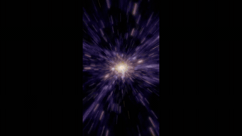](https://wutuobangai.top/opus55-video-prompts.html?utm_source=github&utm_medium=readme&utm_campaign=opus55-repo#p-2103837519615774895)

**作者 [@MiaAI_lab](https://x.com/MiaAI_lab/status/2103837519615774895)** · [看完整效果](https://wutuobangai.top/opus55-video-prompts.html?utm_source=github&utm_medium=readme&utm_campaign=opus55-repo#p-2103837519615774895) · 收录时播放量 75,318

收录来源：[yihui-dev](https://github.com/yihui-dev/awesome-opus5-5-videos) · MIT / [Li-Evan](https://github.com/Li-Evan/awesome-opus-5.5-video-prompts) · CC BY 4.0

输入一个词就生成一整个宇宙的实时视听作品：星星、星系、行星都用着色器画，Web Audio 实时出音乐，不用素材文件。

<details>
<summary>展开完整中文提示词</summary>

```text
给我做一个东西，让人看到时会说「Wow」。必须有沉浸感，让人看到时被眼前的画面震住。

它可以是一段视频，也可以是你能想到的任何别的东西。

要有创意。放开了做。往深里挖。

不要 AI 垃圾。要独特，跳出框框思考。往大处想。往惊艳处想。做一个其他模型从没做过的东西。

要有骄傲感。拿出你最好的水平。别让我失望。
```

</details>

<details>
<summary>查看原文提示词</summary>

```text
Build me something when people see it, they will say "Wow". Must be immersive, when people see it, they will be stunned by what they see.

This can be a video, or anything else you can think of.

Be creative. Go wild. Dig deep.

No AI slop. Something unique, think outside of the box. Think big. Think amazing. Something no other model done before.

Be proud. Show your best. Don't disappoint.
```

</details>

#### 24 · 穿过复古物件的无限缩放

[](https://wutuobangai.top/opus55-video-prompts.html?utm_source=github&utm_medium=readme&utm_campaign=opus55-repo#p-2103129343253778767)

**作者 [@koldo2k](https://x.com/koldo2k/status/2103129343253778767)** · [看完整效果](https://wutuobangai.top/opus55-video-prompts.html?utm_source=github&utm_medium=readme&utm_campaign=opus55-repo#p-2103129343253778767) · 收录时播放量 67,550

收录来源：[yihui-dev](https://github.com/yihui-dev/awesome-opus5-5-videos) · MIT / [Li-Evan](https://github.com/Li-Evan/awesome-opus-5.5-video-prompts) · CC BY 4.0

20 秒无缝循环的无限缩放，穿过怀表、放大镜等复古物件飞进下一片风景，素材都经 Magnific MCP 生成。

<details>
<summary>展开完整中文提示词</summary>

```text
做一个循环的「无限缩放」动画，After Effects 风格：镜头穿过一件件复古物件，从一片风景飞到另一片风景。

外观：复古拼贴风格的写实照片风景 + 黑白报纸剪贴物件（半色调网点、白色纸边、柔和阴影）。胶片颗粒、暗角、光线闪烁。

世界（循环）：雪山 → 怀表（挂在表链上摆动）→ 海崖 → 箱式相机镜头 → 沙漠沙丘 → 放大镜 → 雾湖 → 手镜 → 回到开头。
点缀：漂浮的帽子、电话、雨伞、留声机、钥匙；一个 1950 年代的男人朝怀表走去；一头鲸鱼游过海崖上方的天空。

做法：
- 所有东西都通过 Magnific MCP 生成（Seedream 5 Pro 生成风景，GPT 2.5 生成透明底剪贴物件，深度图，Kling 2.5 做动画，Lyria 3 做音乐）。先列出要生成的内容和点数花费，等我确认后再开始。
- 根据深度图把每片风景拆成 3 个深度层，并补全被遮住的区域。视差：图层缩放 = camera^Z，Z 在 0.45 到 1.22 之间。
- 每个「传送门」的玻璃里装着下一个世界；当它填满画面时无缝切换。
- 匀速：朝一个固定点做指数缩放，每段的时长与 log(zoom) 成正比。逐帧检查切换点。
- 男人和鲸鱼：在纯绿色（#00B140）背景上生成，用 Kling 原地做动画，逐帧抠像，做成无缝循环（需要的话来回播放）。
- 剪贴物件以 15 fps 动（一拍二）。
- 20 s 循环，1920×1080，30 fps。音乐：96 BPM，剪成正好 8 小节 = 20 s。

交付：一个交互式 artifact（查看器、AE 风格的时间线、音乐 + MP4 下载），以及一个带音乐、小于 30 MB 的渲染好的 MP4。
每个花钱的步骤之前，先给我看截图。
```

</details>

<details>
<summary>查看原文提示词</summary>

```text
Build a looping "infinite zoom" animation, After Effects style: the camera
travels from landscape to landscape by flying through vintage objects.

LOOK: vintage collage realistic photo landscapes + black & white newspaper
cutout objects (halftone, white paper border, soft shadow). Film grain,
vignette, light flicker.

WORLDS (loop): snowy mountains → pocket watch (swinging on its chain) →
sea cliffs → box camera lens → desert dunes → magnifying glass →
misty lake → hand mirror → back to start.
Extras: floating hat, phone, umbrella, gramophone, key; a 1950s man walking
toward the watch; a whale swimming across the cliffs sky.

HOW:
- Generate everything via the Magnific MCP (Seedream 5 Pro landscapes,
  GPT 2.5 transparent cutouts, depth maps, Kling 2.5 animation, Lyria 3
  music). List the generations + credit cost and wait for my OK first.
- Split each landscape into 3 depth layers from its depth map and fill the
  hidden areas. Parallax: layer scale = camera^Z, Z between 0.45 and 1.22.
- Each portal's glass holds the next world; cut seamlessly when it fills
  the frame.
- Constant speed: exponential zoom to a fixed point, each segment's duration
  proportional to log(zoom). Verify the cuts frame by frame.
- Man & whale: generate on pure green (#00B140), animate in place with
  Kling, key out every frame, build a seamless loop (ping-pong if needed).
- Cutouts animate at 15 fps (on twos).
- 20 s loop, 1920×1080, 30 fps. Music: 96 BPM, cut to exactly 8 bars = 20 s.

DELIVER: an interactive artifact (viewer, AE-style timeline, music +
MP4 download) and a rendered MP4 with music under 30 MB.
Show me screenshots before each expensive step.
```

</details>

<a id="category-remix"></a>

### 改编与复刻

#### 25 · 原始素材剪成快节奏短视频

[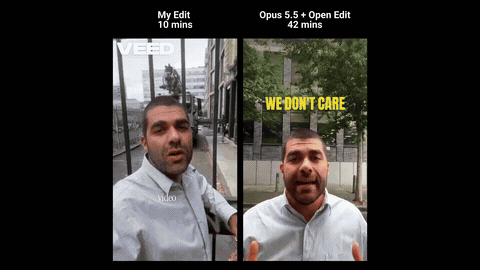](https://wutuobangai.top/opus55-video-prompts.html?utm_source=github&utm_medium=readme&utm_campaign=opus55-repo#p-2103591152847118409)

**作者 [@sab8a](https://x.com/sab8a/status/2103591152847118409)** · [看完整效果](https://wutuobangai.top/opus55-video-prompts.html?utm_source=github&utm_medium=readme&utm_campaign=opus55-repo#p-2103591152847118409) · 收录时播放量 24,174

收录来源：[Li-Evan](https://github.com/Li-Evan/awesome-opus-5.5-video-prompts) · CC BY 4.0

用 Open Edit 把原始素材剪成 20 秒社媒短视频：删掉停顿和口头禅，按参考样式加字幕，配图形和音乐。

<details>
<summary>展开完整中文提示词</summary>

```text
使用 Open Edit - 你能把这段视频剪成一条节奏明快的社交媒体短视频吗？去掉停顿和口头禅，并按照我给你的参考样式给视频加字幕。要剪得有趣，带字幕、图形和音乐
```

</details>

<details>
<summary>查看原文提示词</summary>

```text
Use Open Edit - Can you edit this video into a snappy, fast-paced social media video with silences and filler words removed, and add subtitles to the video in the style of the reference that I've given you. It needs to be a fun edit with subtitles, graphics and music
```

</details>

#### 26 · 给播客成片插满讲解动画

[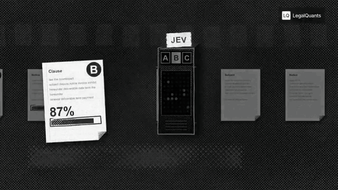](https://wutuobangai.top/opus55-video-prompts.html?utm_source=github&utm_medium=readme&utm_campaign=opus55-repo#p-2103896101120356793)

**作者 [@stokebuilder](https://x.com/stokebuilder/status/2103896101120356793)** · [看完整效果](https://wutuobangai.top/opus55-video-prompts.html?utm_source=github&utm_medium=readme&utm_campaign=opus55-repo#p-2103896101120356793) · 收录时播放量 1,654

收录来源：[yihui-dev](https://github.com/yihui-dev/awesome-opus5-5-videos) · MIT / [Li-Evan](https://github.com/Li-Evan/awesome-opus-5.5-video-prompts) · CC BY 4.0

多 Agent 流程：在播客成片中找 35–50 处，插入统一品牌的全屏 HyperFrames 动画，保留画中画。

<details>
<summary>展开完整中文提示词</summary>

```text
把整期 [episode] 成片从头过一遍，凡是有帮助的地方都加上全屏动画和图形。要激进、宁多勿少：35–50 个时间点，每章至少 2 个。目标是填满空洞的口播时段、讲清观点、制造视觉钩子。

风格。选一种真正有意思、非常非常酷的美学，用 JavaScript 和 HyperFrames 制作，在 Tesseract 里组装。灵感参考（全是 JS，没有图片素材）：

https://x.com/Voxyz_ai/status/2102531681450119426：纸张、打字机标签带、手绘记号
https://x.com/donaldjewkes/status/2102801274173587569：半调网点、漫画和像素印刷、动态数据字体

严格遵守 LegalQuants 品牌（读 brands/legalquants/）：只用炭灰、白色和黑色，字体 Arial，右上角放提供的组合标志，保持静止。先写一份共享的风格手册和一套组件库，让每个动画看起来都属于同一档节目。

我一定要的时间点：

[LIST]

规则

只要有内容全屏（动画、屏幕共享或静态图），我们中的一个人就以画中画出现在右下角，跟随正在说话的人。
不要对摄像机画面做推近或缩放。让每位说话人保持大致居中。
文案必须逐字引用或忠实于所说内容。绝不编造事实、数字或引语。
每个动画的节奏点都要与说出的话同步。
每个图形都要放在一段未剪断的连续音频之内，图形之间留几秒人脸画面。

流程

一个 extra-high effort 的 Opus 5.5 agent 找出每个可以用动画填补空白、抓住观众的时间戳，并为每个给出创意构思。
medium effort 的 Opus 5.5 制作每个动画。
extra-high effort 的 Opus 5.5 对每个动画评审一次，标准是与其他动画的品牌一致性、视觉趣味、与叙事的相关性以及创意判断。
只有评审认为特别糟糕的片段才返工修改。不要全面重做的循环。
组装完整成片，每个全屏画面都内嵌画中画，并给我一个包含各个单独动画的文件夹。
```

</details>

<details>
<summary>查看原文提示词</summary>

```text
Go through the entire [episode] cut and add full-screen animations and graphics wherever they help. Be aggressive and over-inclusive: 35–50 moments, at least 2 per chapter. The goal is to fill empty talking-head time, explain ideas, and create visual hooks.

Style. Pick an aesthetic that's genuinely interesting and very, very cool, built in JavaScript with HyperFrames and assembled in Tesseract. Inspiration (all JS, no image assets):

https://x.com/Voxyz_ai/status/2102531681450119426: paper, typewriter-tape labels, hand-drawn marks
https://x.com/donaldjewkes/status/2102801274173587569: halftone, manga and pixel print, kinetic data type

Stay inside the LegalQuants brand (read brands/legalquants/): charcoal, white and black only, Arial, and the supplied lockup top-right, static. Write a shared style bible and a component kit first, so every animation looks like the same show.

Moments I definitely want:

[LIST]

Rules

Whenever anything goes full-screen (animation, screen share or still), one of us is in a corner picture-in-picture, bottom-right, following whoever is talking.
No punch-ins or zooming on the cameras. Keep each speaker relatively centered.
Copy must be verbatim or faithful to what's said. Never invent facts, numbers or quotes.
Sync each animation's beats to the spoken words.
Keep each graphic inside one uncut stretch of audio, and leave a few seconds of faces between graphics.

Process

An Opus 5.5 agent at extra-high effort finds every timestamp where an animation could fill space and hook the viewer, with a concept for each.
Opus 5.5 at medium effort builds each animation.
Opus 5.5 at extra-high effort judges each one once on brand consistency with the others, visual interest, relevance to the narrative and creative judgment.
Only cues the judge considers egregiously bad go back for a fix. No blanket redo loops.
Assemble the full cut with PiP baked into every full-screen visual, and give me a folder of the individual animations.
```

</details>

#### 27 · 逐帧换装的跑酷子弹时间

[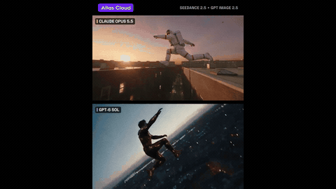](https://wutuobangai.top/opus55-video-prompts.html?utm_source=github&utm_medium=readme&utm_campaign=opus55-repo#p-2103035980068557220)

**作者 [@Kiana_Liang0609](https://x.com/Kiana_Liang0609/status/2103035980068557220)** · [看完整效果](https://wutuobangai.top/opus55-video-prompts.html?utm_source=github&utm_medium=readme&utm_campaign=opus55-repo#p-2103035980068557220) · 收录时播放量 880

收录来源：[Li-Evan](https://github.com/Li-Evan/awesome-opus-5.5-video-prompts) · CC BY 4.0

先用 Seedance 2.5 生成跑酷子弹时间镜头，再逐帧换风格；Opus 重绘了 189 帧、11 种造型。

<details>
<summary>展开完整中文提示词</summary>

```text
第 1 步：用 Seedance 2.5 文生视频生成基础镜头。一个跑酷少年从屋顶边缘跃起，飞越两栋楼之间的空隙。到最高点时，时间几乎停住，镜头绕着他转半圈（子弹时间）。随后时间恢复，他落到对面屋顶，翻滚一圈站起身。

第 2 步：从基础镜头里抽帧，用图像模型逐帧重绘风格，让他在动作中途不断切换造型，像《瞬息全宇宙》那样，然后自动剪回一段完整视频。

什么时候开始换、多久换一次、换成哪些造型，由你决定。至少 6 种造型。动作、姿势、构图和背景必须和基础镜头一致。只有角色的造型会变。
```

</details>

<details>
<summary>查看原文提示词</summary>

```text
Step 1: Generate the base shot with Seedance 2.5 text-to-video. A parkour kid leaps off a rooftop edge across the gap between two buildings. At the peak, time almost stops and the camera orbits halfway around him (bullet time). Then time resumes, he lands on the opposite roof and rolls to his feet.

Step 2: Pull frames from the base, restyle them frame by frame with an image model so he flips through different looks mid-action, Everything Everywhere All at Once style, then automatically cut it back into one full video.

When to start, how often to switch, which looks: your call. At least 6 looks. Action, pose, framing and background must match the base. Only the character's look changes.
```

</details>

<a id="category-interactive"></a>

### 可互动网页

#### 28 · 奇异建筑三维世界漫游

[](https://wutuobangai.top/opus55-video-prompts.html?utm_source=github&utm_medium=readme&utm_campaign=opus55-repo#p-2103194052850241739)

**作者 [@LexnLin](https://x.com/LexnLin/status/2103194052850241739)** · [看完整效果](https://wutuobangai.top/opus55-video-prompts.html?utm_source=github&utm_medium=readme&utm_campaign=opus55-repo#p-2103194052850241739) · 未记录播放量

收录来源：[yihui-dev](https://github.com/yihui-dev/awesome-opus5-5-videos) · MIT

创建可自由探索的三维世界，展示奇异建筑、遗迹与自然景观。

<details>
<summary>展开完整中文提示词</summary>

```text
创建一个电影感的浏览器 3D 世界，可以用镜头自由探索，重点呈现令人屏息的景观和非凡的原创建筑。让世界充满巨大的奇异建筑、宏伟结构、超现实遗迹、悬崖、山谷、森林、水体，以及有着极丰富细节的独特形态，带来神秘和震撼感。这不是游戏，也不以战斗为重点，目标是纯粹的探索、氛围、构图和视觉发现。让这个世界宏大、细节丰富、完全原创，建筑要奇特、大胆，让人过目不忘。
```

</details>

<details>
<summary>查看原文提示词</summary>

```text
Create a cinematic browser-based 3D world that can be explored freely with a camera, focused on breathtaking landscapes and extraordinary original architecture. Fill the world with huge strange buildings, monumental structures, surreal ruins, cliffs, valleys, forests, water, and unusual ultra-detailed forms that feel mysterious and awe-inspiring. This is not a game and not combat-focused, the goal is pure exploration, atmosphere, composition, and visual discovery. Make the world feel epic, highly detailed, and completely original, with architecture that looks weird, ambitious, and unforgettable.
```

</details>

#### 29 · 山间小镇的四车竞速

[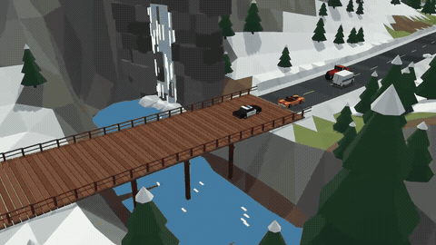](https://wutuobangai.top/opus55-video-prompts.html?utm_source=github&utm_medium=readme&utm_campaign=opus55-repo#p-2103128800909197521)

**作者 [@_nieGRAMotny_](https://x.com/_nieGRAMotny_/status/2103128800909197521)** · [看完整效果](https://wutuobangai.top/opus55-video-prompts.html?utm_source=github&utm_medium=readme&utm_campaign=opus55-repo#p-2103128800909197521) · 未记录播放量

收录来源：[yihui-dev](https://github.com/yihui-dev/awesome-opus5-5-videos) · MIT

制作四种车辆比拼加速、穿过冰面和铁路道口的赛车游戏。

<details>
<summary>展开完整中文提示词</summary>

```text
制作一款受 Ignition（1997）启发的赛车游戏：倾斜俯视镜头，偏街机风格的
物理效果，以及个性十分鲜明的车辆。这必须是一款原创游戏，
而不是复制品。使用原创名称、原创赛道，不使用任何原作素材。

## 技术栈
- Vite + TypeScript（strict），Three.js 负责渲染，不用界面框架
  （HUD 用纯 DOM/CSS）。
- 用代码生成低多边形画面（BoxGeometry、CylinderGeometry 等），
  不用外部模型或纹理。使用纯色和简单材质。
- 自定义简化的 2.5D 物理（在 XZ 平面移动，高度由地形决定）。
  不用物理引擎。

## 架构
- src/game/（固定时间步长的游戏循环）、src/vehicles/、src/track/、src/ai/，
  src/render/, src/ui/
- 车辆由数据驱动：质量、动力、最高速度、抓地力、转向、碰撞
  抵抗力和加速参数（强度、持续时间、充能时间）。
  一个 Vehicle 类，不同配置。
- 任何车辆都可以由玩家或 AI 控制
  （共用控制接口：油门、刹车、转向、加速）。
- 赛道用数据表示：中心线样条 + 宽度 + 区域列表
  （冰面、捷径、障碍）。据此生成道路网格和 AI 路径点。

## 车辆（原创名称，无品牌）
四辆车。玩家在选择画面选一辆；剩余 3 辆
由 AI 驾驶。
- 90 年代风格的警用轿车（黑白配色、警灯条）：重、稳，
  碰撞时推力强。
- 敞篷肌肉车：直道最快，过弯时容易转向过度。
- 红色怪兽卡车：慢，但不怕颠簸，能撞开其他所有车。
- 邮政配送厢式车：慢、重心高，过弯时摇晃。
操控差异必须明显。四辆车都必须能玩，
也都要有竞争力。较慢的车辆可以靠抗碰撞能力、
地形适应能力，或更强、更频繁的加速来补偿。

## 加速
- 每辆车都有加速功能：在短时间内明显加速，超过其
  正常最高速度。
- 加速能量自动从 0 充到 100%。只有达到 100% 才能使用。
  使用后，能量条降到 0，重新开始充能。
- 每辆车的强度、持续时间和充能时间都不同
  （例如肌肉车：时间短、强度很高；厢式车：较弱但充能快；
  怪兽卡车：时间长，但充能慢）。
- 加速时的视觉效果：排气火焰或拖尾，镜头稍微
  拉远。
- AI 也要合理使用加速：在直道上用，不在急弯前
  或冰面上用。

## 赛道
一座有加拿大风情的山间小镇，冬季正在转入春融：
- 闭合环路，每圈大约 60–90 seconds
- 从赛道上能看到瀑布，还有一座跨河木桥
- 一个铁路道口，定期有火车经过
  （碰撞 = 强烈击退，不是游戏结束）
- 抓地力降低的冰面
- 一条捷径（狭窄、危险）；装饰：云杉、木屋、积雪
- 设置护栏或天然障碍，防止车辆困在赛道外。
  兜底机制：如果车辆（包括电脑车）卡住超过 ~4 s，
  自动把它送回最后一个检查点处的赛道。

## 玩法
- 3 圈，发车位静止起跑，3-2-1 倒计时
- AI 沿路径点行驶，驾驶风格随车辆变化，
  轻度动态追赶平衡、避障，不瞬移（上述
  卡住后返回赛道的兜底机制除外）
- 滑行完全来自物理（抓地力、速度、冰面），没有手刹
- 镜头：~50° 俯视，跟随玩家，并沿前进
  方向稍微看向前方
- 操作：方向键/WASD（油门、刹车/倒车、转向），空格 = 加速
- 画面：开始 → 选车（模型预览 + 属性条，包括
  加速）→ 比赛 → 结果 → 重新开始（可更换车辆）

## HUD
- 名次、圈数、单圈时间、最佳圈速、小地图。
- 加速条做成汽车电池样式：矩形外壳，顶部有两个接线端子
  （+/−），充能时内部填充量上升。颜色从红色经过
  黄色变成绿色。达到 100% 时，电池要明确提示可用（脉动或
  发光、“加速”字样或闪电图标）。加速期间，能量条
  快速消耗。

## v1 不包含的内容
声音、选项菜单、多赛道、多人模式、保存状态。

## 工作流程
1. 先提出计划和文件结构，再分阶段实现：
   (a) 游戏循环 + 平面上的一辆车，包括加速，
   (b) 赛道，(c) 其余车辆和 AI，(d) 障碍和火车，
   (e) 选车、带电池能量条的 HUD，以及各个画面。
2. 每个阶段后运行 `npm run build`，修复类型错误。
3. 为车辆物理、加速逻辑（充能、
   低于 100% 禁用、使用后重置），以及圈数/名次逻辑添加单元测试（Vitest）。
4. 最后：写一份 README，说明操作方式，以及如何添加新赛道
   或车辆。

## 验收标准
`npm install && npm run dev` 能启动游戏。可以从 4 辆车中任选一辆，
与 3 辆电脑车比赛并完成 3 圈。每辆车操控不同，
加速也明显不同。只有电池满了才能加速，
电脑车也会使用。火车和冰面正常工作。结果显示正确名次。
普通笔记本上稳定达到 60 FPS。
```

</details>

<details>
<summary>查看原文提示词</summary>

```text
Build a racing game inspired by Ignition (1997): angled top-down camera, arcade-leaning
physics, vehicles with very distinct personalities. This must be an original game,
not a copy. Use an original name, an original track, and zero original assets.

## Stack
- Vite + TypeScript (strict), Three.js for rendering, no UI framework
  (HUD in plain DOM/CSS).
- Low-poly graphics generated in code (BoxGeometry, CylinderGeometry, etc.),
  no external models or textures. Solid colors and simple materials.
- Custom simplified 2.5D physics (movement on the XZ plane, height from terrain).
  No physics engine.

## Architecture
- src/game/ (game loop with fixed timestep), src/vehicles/, src/track/, src/ai/,
  src/render/, src/ui/
- Vehicles are data-driven: mass, power, top speed, grip, steering, collision
  resistance, and boost parameters (strength, duration, recharge time).
  One Vehicle class, different configurations.
- Any vehicle can be controlled by either the player or the AI
  (shared control interface: throttle, brake, steer, boost).
- Track as data: centerline spline + width + list of zones
  (ice, shortcut, obstacle). Generate the road mesh and AI waypoints from it.

## Vehicles (original names, no brands)
Four vehicles. The player picks one on the selection screen; the remaining 3
are driven by the AI.
- 90s-style police sedan (black and white, light bar): heavy, stable,
  pushes hard in collisions.
- Muscle car convertible: fastest on straights, oversteers in corners.
- Red monster truck: slow, but ignores bumps and rams everything else.
- Postal delivery van: slow, high center of gravity, sways in corners.
The handling differences must be clearly noticeable. All four must be playable
and competitive. Slower vehicles compensate with e.g. collision resistance,
terrain handling, or a stronger or more frequent boost.

## Boost
- Every vehicle has a boost: a short, pronounced acceleration beyond its
  normal top speed.
- Boost charges automatically from 0 to 100%. It can only be used at 100%.
  After use, the meter drops to 0 and starts charging again.
- Strength, duration and recharge time are unique to each vehicle
  (e.g. muscle car: short and very strong; van: weaker but recharges fast;
  monster truck: long but slow to recharge).
- Visual effect while boosting: exhaust flame or trail, slight camera
  pull-back.
- The AI also uses boost, sensibly: on straights, not before sharp corners
  or on ice.

## Track
A mountain town with a Canadian feel, winter turning into spring thaw:
- closed loop, roughly 60–90 seconds per lap
- a waterfall visible from the track and a wooden bridge over a river
- a railroad crossing with a train passing periodically
  (collision = strong knockback, not game over)
- ice patches with reduced grip
- one shortcut (tight, risky); decorations: spruce trees, wooden houses, snow
- barriers or natural obstacles so vehicles can't get stuck off the track.
  Failsafe: if a vehicle (including bots) is stuck for more than ~4 s,
  automatically return it to the track at the last checkpoint.

## Gameplay
- 3 laps, standing grid start, 3-2-1 countdown
- AI follows waypoints with a driving style that depends on the vehicle,
  light rubber-banding, avoids obstacles, no teleporting (except the
  failsafe track return described above)
- Sliding comes purely from physics (grip, speed, ice), no handbrake
- Camera: top-down at ~50°, follows the player with a slight look-ahead
  in the direction of travel
- Controls: arrows/WASD (throttle, brake/reverse, steering), space = boost
- Screens: start → vehicle selection (model preview + stat bars, including
  boost) → race → results → restart (with option to change vehicle)

## HUD
- Position, lap, lap time, best lap, minimap.
- Boost meter styled as a car battery: rectangular casing with two terminals
  (+/−) on top, fill level rises as it charges. Color shifts from red through
  yellow to green. At 100% the battery clearly signals readiness (pulsing or
  glow, "BOOST" label or lightning bolt icon). While boosting, the meter
  drains quickly.

## Out of scope for v1
Sound, options menu, multiple tracks, multiplayer, save state.

## Workflow
1. First propose a plan and file structure, then implement in stages:
   (a) game loop + one vehicle on a flat plane, including boost,
   (b) track, (c) remaining vehicles and AI, (d) obstacles and train,
   (e) vehicle selection, HUD with battery meter, and screens.
2. After each stage run `npm run build` and fix type errors.
3. Add unit tests (Vitest) for vehicle physics, boost logic (charging,
   lockout below 100%, reset after use), and lap/position logic.
4. Finally: a README describing the controls and how to add a new track
   or vehicle.

## Acceptance criteria
`npm install && npm run dev` launches the game. You can pick any of the 4
vehicles and complete 3 laps against 3 bots. Each vehicle handles differently
and has a noticeably different boost. Boost only works with a full battery,
and bots use it too. The train and ice work. Results show the correct order.
Stable 60 FPS on an average laptop.
```

</details>

#### 30 · 手游奖励升级与揭晓动效

[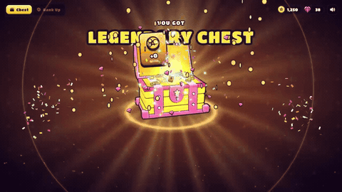](https://wutuobangai.top/opus55-video-prompts.html?utm_source=github&utm_medium=readme&utm_campaign=opus55-repo#p-2103724883301814408)

**作者 [@op7418](https://x.com/op7418/status/2103724883301814408)** · [看完整效果](https://wutuobangai.top/opus55-video-prompts.html?utm_source=github&utm_medium=readme&utm_campaign=opus55-repo#p-2103724883301814408) · 未记录播放量

收录来源：[yihui-dev](https://github.com/yihui-dev/awesome-opus5-5-videos) · MIT

制作可点击播放、包含升级蓄力和奖励结算的手游动效。

<details>
<summary>展开完整中文提示词</summary>

```text
帮我做一个原创的手游「高光时刻」动效：[主体，例如：开宝箱 / 段位晋升 / 成就解锁 / Boss 掉落 / 角色升级]。
做成一个可以直接打开的单文件网页（HTML + CSS + JS），点一下就能完整播放，效果对标商业手游的结算 / 奖励演出。

【世界观与风格】
- 原创美术，不要模仿任何现有游戏的 IP、角色或 Logo。
- 卡通手游风：高饱和配色，统一的深色描边（例如 #1A1033），圆润厚重的造型。
- 配色随等级升级：[等级阶梯，例如：普通绿 → 稀有蓝 → 史诗紫 → 传说金]。每升一级都要切换主色、光效颜色和背景色调。
- 标题用圆胖的游戏字体（如 Titan One / Lilita One），描黑边，加投影；文字逐字「砸」进画面，带回弹。

【主体物：做成真 3D】
- 用 Three.js 建模，不要用平面 SVG 贴图。要有厚度、倒角，以及符合主体的结构细节（木板缝、铆钉、包边、宝石切面、锁扣等）；木板缝这类细节用真实几何体拼出来，不要贴黑线条。
- 着色用卡通分阶（MeshToonMaterial 加 3～4 阶的渐变贴图），配三种灯光：主光、天光、等级色的轮廓光。
- 描边用后期边缘检测：渲染法线图 + 深度图，再用着色器画线。外轮廓粗、零件交界细，粗细全程一致；另外做 1.5 倍超采样和多重采样抗锯齿。
  不要用「放大一圈的黑色背面」那种描边，那样粗细不均、转角会断。
  深度判断的阈值要放宽，接缝主要靠法线判断，否则斜着看的表面会冒出细碎斜纹。
- 活动部件要真实运动，比如箱盖绕铰链翻开、奖章绕竖轴旋转。
- 待机时主体缓慢左右转动，让人看到侧面和厚度，同时轻微上下浮动；脚下要有随高度变化的柔和投影。

【如果画面里有 2D 插画（卡面、奖励图标、角色）】
- 三层卡通着色：底色、成块的阴影色、高光色，不要只用一层渐变。
- 线条分粗细：外轮廓粗，内部结构线细。
- 每个角色或物件要有自己的表情和姿态，不要所有东西共用同一张脸。
- 脚下画投影，让主体「站」在画面里；背景按属性区分图案，不要全用同一套放射线。

【演出节奏：五个阶段，缺一不可】
1. 预备：主体待机浮动，每隔几秒抖一下提示可以点击，底部显示「点击」提示。
2. 升级：每点一次，主体跳起、在空中转一圈、落地时压扁再回弹；同时切换到下一等级的颜色，闪一下光，冒一圈粒子，标题更新。
3. 蓄力（约 1 秒）：主体越抖越剧烈，缝隙透出光，四周粒子往中心吸，音效音调持续上升；最后一刻猛地压扁。
4. 爆发：从爆点向外扩散的泛光闪白、屏幕震动、镜头往前一推、多层冲击波、细长流光迸射、闪光星点、金币和宝石（带旋转）。高等级的爆发要明显更强。彩带只在最高潮用一次，不要满屏彩带。
5. 揭晓与结算：
   - 奖励卡片从主体里沿弧线飞出，落位时带超调和晃动收尾，数字滚动计数。
   - 稀有物品带彩虹流光边框和「NEW!」角标。
   - 点击领取后，金币和宝石沿贝塞尔曲线飞进右上角的余额，每到一个余额就跳一下。

【揭晓舞台：让主角独占画面】
- 最高稀有度揭晓时，其他元素收起或淡出，背后换成一层干净的渐变幕布加缓慢旋转的柔光，不要让主角压在杂乱的背景上。
- 幕布出现时，把场景里的其他 3D 物件隐藏掉，否则后期描边会把它们的轮廓线画在幕布上。
- 主角的外发光要放在主体背后，只从边缘溢出，不能盖在主体前面把它糊成一片白。
- 可以加一圈围绕主角盘旋的星尘拖尾，但轨道必须完整在主角轮廓外侧，不能从主体正面扫过。

【光效：必须柔和，不能有硬边】
- 背景光芒：用带渐变过渡的 conic-gradient，不要一刀切的色块边缘；叠 2～3 层不同密度、不同转速的光。
- 光柱：由 5～7 道带模糊的光束呈扇形散开，亮度各自轻微闪动；根部加一团柔光核心，光里有光尘缓慢上飘。
- 闪白：从爆点向外的径向泛光（mix-blend-mode: screen），强度不超过 0.8，不要整屏纯白过曝。
- 粒子：每个火花都带一圈低透明度的外晕；冲击波用三层描边（宽而淡、中等、细而亮）。

【材质与界面】
- 边框、名牌、按钮要有材质感：金属拉丝渐变、左上亮右下暗的倒角光、内阴影；按稀有度换镶嵌件（钢铆钉 → 银框宝石 → 金框钻石加小王冠）。
- 小卡片上不要塞小字数值；详细数值放到揭晓时的信息面板里，面板里的数字滚动上涨，并弹出「▲+数值」。
- 画在 Canvas 上的贴图，分辨率至少是屏幕上最大显示尺寸的 1.5 倍，否则放大时会发虚。

【动画原则】
- 用 GSAP 时间线编排。所有动作都要有挤压拉伸、超调和弹性回弹，不要匀速。
- 粒子系统用 Canvas 2D 自己写：重力、阻力、生命周期、叠加混合，以及「吸入」「曲线飞行」「环绕」三种运动。
- 不要用 CSS 3D 透视去翻转大尺寸元素，放大加侧翻时会被投影成铺满屏幕的平面，3D 翻转一律放在 WebGL 里做。
- 所有「抖动」「呼吸」类的循环补间，在状态切换时要先取消再归零，避免它比停止指令晚一帧结束，又把值设回去。

【音效】
- 全部用 Web Audio 实时合成，不用音频文件：跳起、落地、升级和弦、蓄力上升音、爆炸低频加噪声、弹出音、计数滴答、金币叮当、胜利号角。
- 第一次点击时才初始化音频；右上角放静音开关。

【界面与工程】
- 顶部 HUD：模式切换、金币和宝石余额、静音按钮。
- 手机宽度也要能用；遵守「减少动态效果」设置（关闭震屏，减少粒子）。
- 动画状态机要严谨：动画播放中忽略点击，不能出现点击被吞或状态错乱。
- 目标 60fps。第一次打开时就是完整的待机画面，不能是空白。

【交付前自检】
在蓄力、爆发、揭晓、结算这几个时刻各截一张图，逐张检查：
- 主角有没有被光晕、粒子或文字挡住？
- 有没有过曝成一片白？
- 背景是否杂乱，有没有穿帮的描边线？
- 小字是否能看清？
- 结算后是否还有东西在不该动的时候继续抖动？

最后告诉我：每个阶段的时长，以及哪些参数可以调整演出强度。
```

</details>

<details>
<summary>查看原文提示词</summary>

```text

```

</details>

**[继续看全部 927 条：视频效果、中文／原文、一键复制 →](https://wutuobangai.top/opus55-video-prompts.html?utm_source=github&utm_medium=readme&utm_campaign=opus55-repo)**

## 来源与署名

整理来源：[yihui-dev/awesome-opus5-5-videos](https://github.com/yihui-dev/awesome-opus5-5-videos)（MIT）与 [Li-Evan/awesome-opus-5.5-video-prompts](https://github.com/Li-Evan/awesome-opus-5.5-video-prompts)（CC BY 4.0）。未使用其他来源合集的内容。

中文标题、分类和译文沿用 Happy AI 站内整理版：部分翻译来自 Li-Evan，其余由 Happy AI 补译；站内曾做删减合并。本仓库再次精选 30 条，增加英文标题和导读，并将视频截取、缩放为无声的 3.5 秒循环 GIF；提示词正文未另行缩写或改写。

每条提示词、视频和预览归原作者所有，作者和原帖列在每条旁边。合集许可不替代原作者对作品的权利，也不表示原作者为本站背书。详细归属见 [CREDITS.md](CREDITS.md)，许可范围及原文见 [LICENSE.md](LICENSE.md) 和 [licenses/](licenses/)。署名更正或移除引用可通过仓库 Issues 联系。

## 更多免费工具

[Happy AI 免费知识库](https://wutuobangai.top/knowledge.html) · [更多工具](https://wutuobangai.top/index.html#tools) · [联系 Happy AI](https://wutuobangai.top/index.html#wechat)
